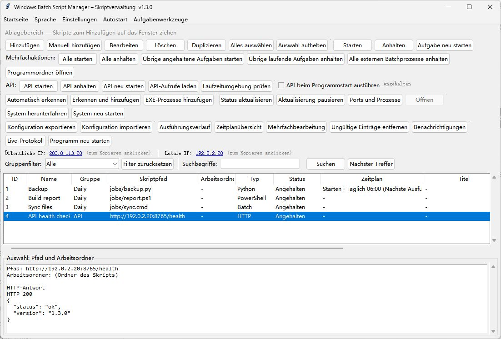

# WindowsBatchScriptManager · Deutsch

[English](README.md) · [简体中文](README.zh-CN.md) · [繁體中文](README.zh-TW.md) · [日本語](README.ja-JP.md) · [한국어](README.ko-KR.md) · [Deutsch](README.de-DE.md) · [Français](README.fr-FR.md) · [Español](README.es-ES.md) · [Português (Brasil)](README.pt-BR.md) · [Русский](README.ru-RU.md)

Verwaltet Batchdateien, Python-, Node.js- und PowerShell-Skripte unter Windows mit Zeitplänen, Warteschlange und Remote-API.

[Für Windows herunterladen](https://github.com/shellsec/WindowsBatchScriptManager/releases)
## Schnellstart

Für die Desktop-Anwendung genügt die einzelne EXE. Für die Remote-API legen Sie EXE und API-Skript auf dem Server in denselben Ordner, installieren die Python-Abhängigkeiten und starten den Dienst. Behalten Sie bei Updates Ihre vorhandenen JSON-Konfigurationsdateien.

```powershell
python -m pip install fastapi "uvicorn[standard]"
python WindowsBatchScriptManager_api_server.py --host 0.0.0.0 --port 8765 --api-key "<API_KEY>"
```

Im Sprachmenü steht die Systemsprache an erster Stelle und English an zweiter Stelle. Die Sprache kann auch manuell gewählt werden.

## Laufwerk C: bereinigen

In v1.3.4 befindet sich die Bereinigung neben der Schaltfläche zum Öffnen des Programmordners. Sie läuft im Hintergrund und zeigt die Ergebnisse unten im Protokoll an. Sie entfernt `.tmp`- und `.temp`-Dateien, die seit mehr als sieben Tagen unverändert sind, aus den temporären Benutzer- und Systemordnern auf C: sowie den Miniaturansichtencache des Benutzers auf C:. Sie **leert den Papierkorb auf C: endgültig und ohne Rückfrage** und löscht den DNS-Cache. Die Bereinigung verwendet die aktuellen Berechtigungen und lässt Windows Update-Cache, Prefetch und Systemprotokolle bestehen.



[API / MCP](docs/USER_GUIDE.en-US.md#remote-api-and-mcp) · [Apache-2.0](LICENSE) · [NOTICE](NOTICE)
