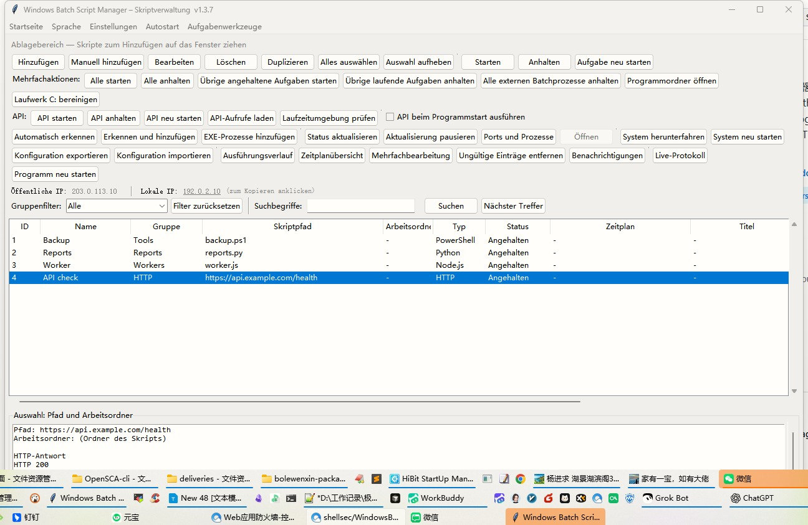

# WindowsBatchScriptManager · Deutsch

[简体中文](README.md) · [English](README.en-US.md) · [繁體中文](README.zh-TW.md) · [日本語](README.ja-JP.md) · [한국어](README.ko-KR.md) · [Deutsch](README.de-DE.md) · [Français](README.fr-FR.md) · [Español](README.es-ES.md) · [Português (Brasil)](README.pt-BR.md) · [Русский](README.ru-RU.md)

Verwaltet Batchdateien, Python-, Node.js- und PowerShell-Skripte unter Windows mit Zeitplänen, Warteschlange und Remote-API.

Für KI-gestützten Fernzugriff mit Codex oder Claude Code aktivieren Sie SSH/SFTP unter Windows in WBSM. Linux und macOS nutzen den vorhandenen SSH-Dienst, standardmäßig über Port 22. [Einrichtung und Beispiele](README.en-US.md#ai-remote-access)

[Für Windows herunterladen](https://github.com/shellsec/WindowsBatchScriptManager/releases)

## Unternehmensszenarien und Lösungen

Zwei unabhängige Einsätze: Windows-Skripte dauerhaft verwalten und Rechner bei Bedarf mit KI über SSH/SFTP warten. Geeignet für kleine Betriebs- und Entwicklungsteams mit bestehenden Scan-, Erfassungs-, Build- oder Backup-Rechnern.

- Bestehende Umgebung nicht neu installieren: Aufgaben und Fernzugriff auf dem vorhandenen Windows einrichten.
- Verteilte Skripte, Argumente und Interpreter: Einstellungen bündeln, Vorlagen, Ordnerimport und Laufzeitauswahl verwenden.
- Zeitpläne, Parallelitätsgrenzen, automatischer Neustart und Folgeschritte: Der laufende Manager übernimmt dies ohne einzelne Windows-Aufgaben einzurichten.
- Wiederholte RDP-Sitzungen: Codex oder Claude Code nutzt SSH für Befehle und SFTP für Dateien, begrenzt durch das Windows-Konto.
- Unklare Fehler: Gespeicherte Ausgabe, Verlauf und HTTP-Antworten im Panel prüfen; Dateiprotokollierung muss aktiviert sein.
- Doppelte Starts bei Updates: Der Update-Neustart überspringt Autostart-Aufgaben und prüft Prozessidentitäten beim Wiederherstellen.
- Mehrere Rechner: Über SSH-Aliase einzeln warten; kein zentrales Flotten-Dashboard.

Zeitpläne, Warteschlangen und Keep-alive benötigen den laufenden Manager. OpenSSH ist ein separater Dienst; das Trennen der Wartungsverbindung stoppt verwaltete Aufgaben nicht von selbst. Direkt über SSH gestartete Befehle hängen von ihrer Startweise ab. GUI-Anwendungen können einen interaktiven Desktop benötigen. Ein vorhandener Prozess beweist keine fachliche Gesundheit; vollständige Auditierung oder Wiederherstellung aller Fehler wird nicht versprochen. Berechtigungen, Updates, Wiederherstellung und Dauerbetrieb vor Produktion testen.

## Aufgaben-MCP

MCP ist vom SSH-Zugriff unabhängig und kann registrierte Aufgaben abfragen, starten, stoppen und neu starten. v1.3.13 ergänzt die lesenden Werkzeuge `get_task_logs` (standardmäßig 100, höchstens 1000 Zeilen aus den letzten 64 KiB) und `get_task_result` (letzter gespeicherter Lauf). Fehlende Einträge oder Exitcodes bedeuten keinen Erfolg; Verlauf ist kein Live-Status. API-Skript und Manager gemeinsam aktualisieren. Lokale Aufgaben und SSH benötigen das API-Skript nicht. [Grenzen](docs/MCP_TASK_DIAGNOSTICS.md)

## Schnellstart

Für die Desktop-Anwendung genügt die einzelne EXE. Für die Remote-API legen Sie EXE und API-Skript auf dem Server in denselben Ordner, installieren die Python-Abhängigkeiten und starten den Dienst. Behalten Sie bei Updates Ihre vorhandenen JSON-Konfigurationsdateien.

```powershell
python -m pip install fastapi "uvicorn[standard]"
python WindowsBatchScriptManager_api_server.py --host 0.0.0.0 --port 8765 --api-key "<API_KEY>"
```

Im Sprachmenü steht die Systemsprache an erster Stelle und English an zweiter Stelle. Die Sprache kann auch manuell gewählt werden.

## Laufwerk C: bereinigen

Die C:-Bereinigung entfernt erkannte `.tmp`-/`.temp`-Dateien ohne Altersgrenze, Miniaturansichten, unterstützte Browser-/Shader-Caches, alte Aufgabenprotokolle und Absturzabbilder und leert den DNS-Cache. Der Papierkorb bleibt erhalten; geschützte Pfade und aktive Browser-Caches werden übersprungen. Die Vorschau zeigt bekannte Cacheorte, standardmäßig ohne Auswahl. Prefetch, einzelne Wiederherstellungspunkte und Ruhezustand sind optional. Rechtsklick öffnet den Speicherort oder kopiert den Pfad; für die Ruhezustandsdatei erscheint ein Hinweis auf versteckte Systemdateien. Das Abschalten benötigt Administratorrechte und deaktiviert Schnellstart. Restdateien werden nicht erzwungen gelöscht oder als freigegebener Speicher gezählt.



[API / MCP](docs/USER_GUIDE.en-US.md#remote-api-and-mcp) · [AGPL-3.0](LICENSE) · [NOTICE](NOTICE)


Ab v1.3.13 gilt AGPL-3.0-only. Kommerzielle Nutzung ist erlaubt; Weitergabe und geänderte Netzwerkdienste unterliegen Quellcodepflichten. Nicht jede private Änderung muss auf GitHub veröffentlicht werden. [Lizenz und Abhängigkeiten](THIRD_PARTY_NOTICES.md)
