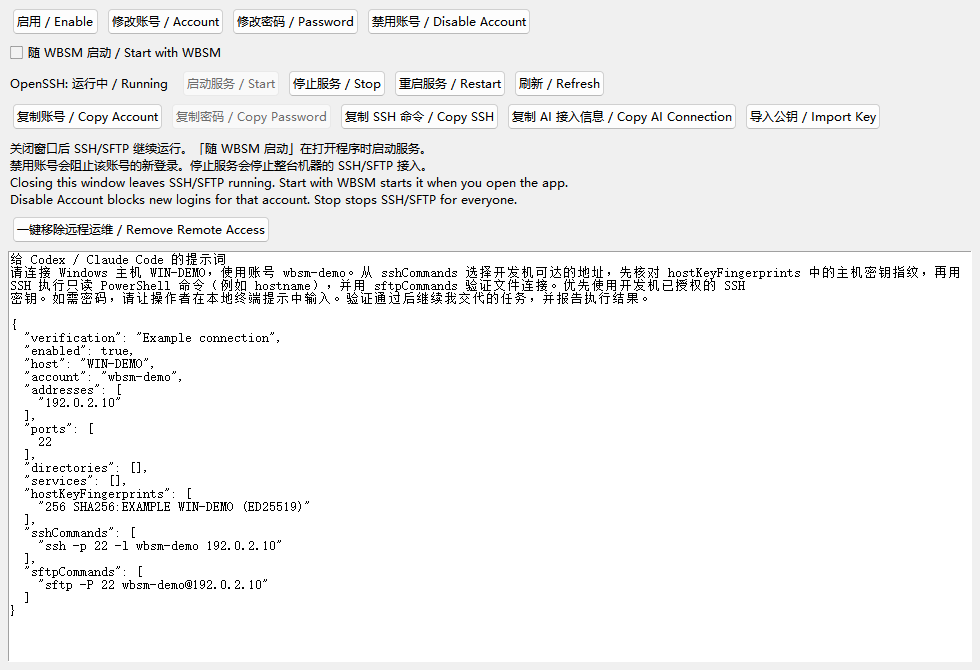

# WindowsBatchScriptManager

Manage batch, Python, Node.js, and PowerShell tasks from a Windows desktop app. Schedule jobs, queue runs, and control tasks remotely through HTTP or MCP.

**Give Codex or Claude Code access to a Windows target.** Enable Remote Access in WBSM and copy the connection details so your AI coding agent can run PowerShell over SSH and transfer files over SFTP.

[](LICENSE)
[](https://github.com/shellsec/WindowsBatchScriptManager/releases/latest)

[简体中文](README.md) · [English](README.en-US.md) · [繁體中文](README.zh-TW.md) · [日本語](README.ja-JP.md) · [한국어](README.ko-KR.md) · [Deutsch](README.de-DE.md) · [Français](README.fr-FR.md) · [Español](README.es-ES.md) · [Português (Brasil)](README.pt-BR.md) · [Русский](README.ru-RU.md)

[Download for Windows](https://github.com/shellsec/WindowsBatchScriptManager/releases) · [User guide](docs/USER_GUIDE.en-US.md) · [AI remote access](#ai-remote-access) · [API and MCP](docs/USER_GUIDE.en-US.md#remote-api-and-mcp)


## When WBSM helps

Two main uses: manage ongoing script tasks on Windows, and give an AI agent SSH/SFTP access for deployment and maintenance. Use either independently.

| Your situation | How WBSM helps |
| --- | --- |
| An existing Windows machine already runs scanners, collectors, builds or other business workloads, and migrating its environment is impractical. | Manage scripts and configure remote access on the existing Windows installation. |
| Scripts are scattered across folders, with different startup commands, arguments and interpreters. | Keep task definitions together; use templates, folder import and per-task runtime settings. |
| Jobs need schedules, concurrency limits, automatic restart or a follow-up step after success/failure. | The running manager provides scheduling, queues, keep-alive and completion rules without configuring Windows Task Scheduler for each job. |
| Routine deployment and troubleshooting repeatedly require Remote Desktop sessions. | Enable OpenSSH and a dedicated account, then let Codex or Claude Code use SSH for commands and SFTP for files within that account's permissions. |
| Failures are hard to investigate across separate consoles. | Inspect recorded output, execution history and HTTP responses in the panel. File logging must be enabled for supported script types. |
| An AI client needs to operate tasks already registered in the panel. | The optional HTTP/MCP service lists tasks, checks process status and starts, stops or restarts them. |
| Restarting the manager during an update could launch startup tasks again. | The update restart skips launch-on-app-start tasks and checks saved process identities when restoring running tasks. This does not promise recovery after every system or process failure. |
| Several Windows machines each run their own workloads. | Keep task managers on each host and maintain hosts individually over SSH, using aliases to identify targets. No central multi-host dashboard is provided. |

**Runtime boundaries.** Scheduling, queue processing and keep-alive require the manager process to remain running; they do not continue merely because a script process survives. OpenSSH runs as a separate service, and disconnecting the maintenance client does not itself stop manager-owned tasks. Commands started directly over SSH have their own session and process behavior. GUI-only applications may still require an interactive desktop. A running process is not proof that its business work is healthy; application health checks and full SSH command auditing are not implied.

The standalone API Python script is optional for local task management and SSH/SFTP access. It is required for the HTTP API and task MCP service, with its own Python dependencies. See [task management](docs/TASK_MANAGEMENT.md) and [remote access](docs/WINDOWS_REMOTE_ACCESS.md).

## Enterprise use cases

For small operations and development teams maintaining existing Windows business machines: scanners, collectors, build hosts, scheduled data processing and backup scripts. Keep the existing OS and runtime environment, manage tasks locally, and use AI-assisted SSH maintenance when needed.

Task management, SSH maintenance and the optional task MCP are separate entry points. This is not a central fleet-management platform or a promise of unattended recovery. Validate permissions, update/recovery behavior and sustained operation in your own environment before production deployment.

## Quick start

1. Open [GitHub Releases](https://github.com/shellsec/WindowsBatchScriptManager/releases) and extract the Windows ZIP.
2. Run `WindowsBatchScriptManager.exe`. The desktop EXE includes its Python runtime.
3. Select **Add**, choose a script, then select **Start**. Python, Node.js, and other tasks use their configured interpreters.

When upgrading, keep your existing `WindowsBatchScriptManager_scripts.json` and other configuration files.

Starting with v1.3.7, use **Check for Updates** beside **Task tools** to check GitHub manually. After confirmation, the Windows single-file EXE downloads and verifies the ZIP, replaces itself, and restarts. The update restart skips tasks configured to launch at startup. Update the standalone API script separately when needed.

## What you can do

- Start, stop, and restart tasks in groups. View ports, logs, and execution history.
- When multiple WBSM installations run side by side, API controls match the service process to the current installation.
- API status checks also cache empty results. OpenSSH status is read directly from the Windows service manager.
- In Edit Script → Basic, enable **Restart when app starts** to restart an owned local task when WBSM opens or start it if stopped.
- Select a run in execution history and choose **Copy AI diagnostics** to copy its status, exit code, and linked log tail. Common credential patterns are masked. Review the output before sharing.
- Create tasks from templates, import a folder, or choose a Python virtual environment, Conda environment, or Node.js version.
- Set schedules, limit concurrent runs, and trigger follow-up tasks based on success or failure.
- Run HTTP tasks and inspect the status code and response body in the details pane.
- Enable SSH and SFTP on Windows, copy AI connection details, and sign in with a password or an imported SSH public key.
- Switch among ten interface languages. The first option follows the system language.

Schedules, queues, and follow-up tasks run while the desktop app is open. [Task management guide](docs/TASK_MANAGEMENT.md)

## C: drive cleanup
Starting with v1.3.9, **Clean up C: drive** removes recognized `.tmp` / `.temp` files without an age limit, thumbnail caches, supported browser and shader caches, inactive task logs, and crash dumps. Results appear in the lower log pane. Protected application/task paths and running browser caches are skipped; the Recycle Bin is kept.

**Disk cleanup preview** lists recognized cache locations on local fixed drives for the current user, rather than scanning arbitrary folders. Items are unchecked by default. Optional entries include Prefetch, individual system restore points, and disabling hibernation. Review the deletion impact before confirming. Right-click an entry to show its file/folder or copy its path; these actions are unavailable for restore points. Hibernation requires administrator permissions and also disables Fast Startup. If Windows leaves `hiberfil.sys` behind, the app reports the failure without counting the space as reclaimed; it does not forcibly delete the file.

To disable hibernation manually, right-click the hibernation item in **Disk cleanup preview** and select **Copy commands to disable hibernation**. Search for **Windows PowerShell** in Start, right-click it, select **Run as administrator**, then choose **Yes** at the prompt. In **Administrator: Windows PowerShell**, paste the three lines at the `PS>` prompt and press Enter.

```powershell
powercfg.exe /hibernate off
cmd.exe /d /c 'del /f /q /a "%SystemDrive%\hiberfil.sys"'
Get-Item -Force -LiteralPath "$env:SystemDrive\hiberfil.sys"
```

The first line disables hibernation and Fast Startup. The second tries to forcibly delete any remaining hibernation file. The third checks for the file. A path-not-found message means the file was removed.

## AI remote access

| Target OS | How to connect |
| --- | --- |
| **Windows** | Open **Remote Access → Enable** in WBSM and approve the administrator prompt. WBSM configures OpenSSH Server and a dedicated standard account. The offline build includes the installer. Select **Copy AI Connection** and share the details with Codex or Claude Code on your development machine. |
| **Linux / macOS** | Use the SSH/SFTP service already enabled on the target. The default port is **22**. No WBSM installation or platform-specific setup is needed. If the service uses a custom port, connect on that port. |



- **Deploy an app.** Update a Python script or EXE on your development machine, upload it with SFTP, then start it over SSH and check its health endpoint.
- **Troubleshoot or edit files.** Inspect processes, download readable logs, update scripts in writable directories, or check whether Python, Git, and Docker are available to the remote account.
- **Connect again.** Import your development machine's SSH public key on the target to sign in without typing a password. Windows account permissions determine which files and commands the agent can access.

Remote Access uses standard SSH and SFTP clients. The HTTP API and MCP below remain available for listing, starting, and stopping tasks configured in WBSM. [Windows remote access setup and verification](docs/WINDOWS_REMOTE_ACCESS.md)

## Remote API and MCP

Run `WindowsBatchScriptManager.exe` on the server and click **Start API / MCP**. WBSM extracts its bundled `WindowsBatchScriptManager_api_server.py` beside the EXE on first use. The API server needs Python and the packages below. Choose a private API key before making the service reachable from another machine.

After installing the dependencies, select **Start API / MCP** in the **API / MCP** area of the main window. Once running, the status shows the MCP URL and **Copy MCP URL** copies it. If startup fails, check the script location and use **Check Runtime** to diagnose dependencies. You can also start it from PowerShell.

```powershell
python -m pip install fastapi "uvicorn[standard]"
python WindowsBatchScriptManager_api_server.py --host 0.0.0.0 --port 8765 --api-key "<your-key>"
```

Use the `X-API-Key` header for HTTP requests. The MCP endpoint is `http://<server>:8765/mcp`. For example, a desktop HTTP task can send `POST /start?id=10` to start task 10 on the server. [API and MCP reference](docs/USER_GUIDE.en-US.md#remote-api-and-mcp)

Starting with v1.3.13, WBSM provides read-only `get_task_logs` and `get_task_result` MCP tools. Update both the API script and manager source/EXE before using them. [Task diagnostics and limitations](docs/MCP_TASK_DIAGNOSTICS.md)

## Documentation

- [CLI and automation](docs/USER_GUIDE.en-US.md#command-line-cli)
- [Run from source on Windows, macOS, or Linux](docs/USER_GUIDE.en-US.md#how-to-run)
- [Build the Windows EXE](PYINSTALLER.md)
- [Contributing](CONTRIBUTING.md) · [AGPL-3.0 license](LICENSE) · [Notices](NOTICE)

## Support the project

[Sponsor on Afdian](https://ifdian.net/a/shellsec) · [aiv123.com](https://aiv123.com/) · [ofox.ai](https://ofox.io/x/aiv123) · [TOKEN2ROI (AI Top-Ups)](https://token2roi.com/)


AGPL-3.0-only applies from v1.3.13. Commercial use is permitted; distribution and modified network deployments have corresponding-source obligations. [License and dependency notices](THIRD_PARTY_NOTICES.md).
