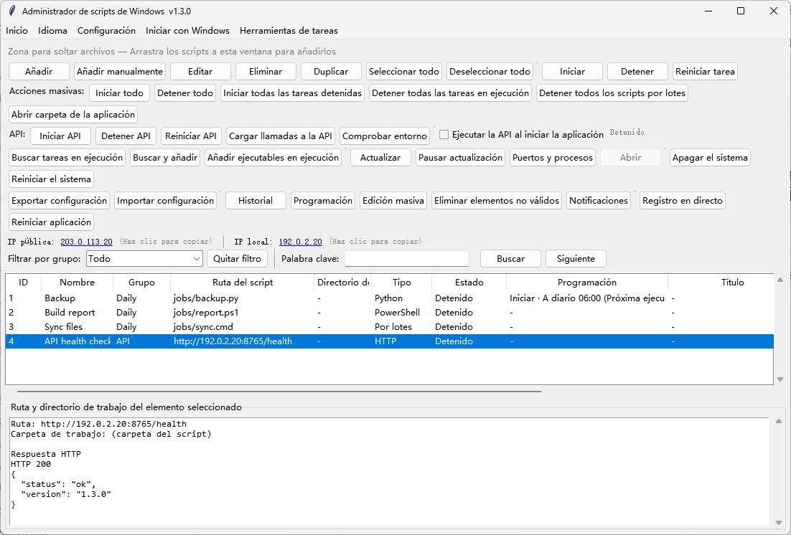

# WindowsBatchScriptManager · Español

[English](README.md) · [简体中文](README.zh-CN.md) · [繁體中文](README.zh-TW.md) · [日本語](README.ja-JP.md) · [한국어](README.ko-KR.md) · [Deutsch](README.de-DE.md) · [Français](README.fr-FR.md) · [Español](README.es-ES.md) · [Português (Brasil)](README.pt-BR.md) · [Русский](README.ru-RU.md)

Gestiona scripts por lotes, Python, Node.js y PowerShell en Windows con programación, cola de ejecución y API remota.

[Descargar para Windows](https://github.com/shellsec/WindowsBatchScriptManager/releases)
## Inicio rápido

Para usar la aplicación de escritorio, ejecuta el EXE autónomo. Para la API remota, coloca el EXE y el script API en la misma carpeta del servidor, instala las dependencias de Python e inicia el servicio. Conserva los archivos JSON de configuración al actualizar.

```powershell
python -m pip install fastapi "uvicorn[standard]"
python WindowsBatchScriptManager_api_server.py --host 0.0.0.0 --port 8765 --api-key "<API_KEY>"
```

La primera opción del menú de idioma sigue al sistema. La segunda es English. También puedes elegir un idioma manualmente.

## Limpiar la unidad C:

En la v1.3.4, el botón de limpieza está junto al que abre la carpeta de la herramienta. La limpieza se ejecuta en segundo plano y muestra cada resultado en el registro inferior. Elimina archivos `.tmp` y `.temp` modificados hace más de siete días en las carpetas temporales del usuario y del sistema en C:, así como la caché de miniaturas del usuario en C:. **Vacía definitivamente la papelera de C: sin pedir confirmación** y limpia la caché DNS. Usa los permisos actuales y conserva la caché de Windows Update, Prefetch y los registros del sistema.



[API / MCP](docs/USER_GUIDE.en-US.md#remote-api-and-mcp) · [Apache-2.0](LICENSE) · [NOTICE](NOTICE)
