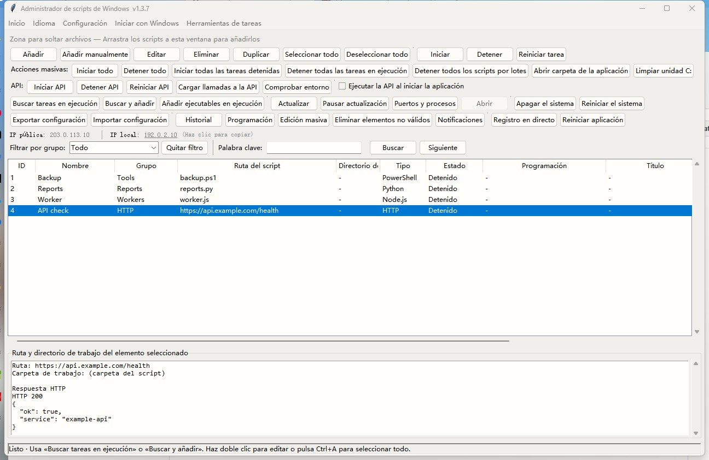

# WindowsBatchScriptManager · Español

[简体中文](README.zh-CN.md) · [English](README.md) · [繁體中文](README.zh-TW.md) · [日本語](README.ja-JP.md) · [한국어](README.ko-KR.md) · [Deutsch](README.de-DE.md) · [Français](README.fr-FR.md) · [Español](README.es-ES.md) · [Português (Brasil)](README.pt-BR.md) · [Русский](README.ru-RU.md)

Gestiona scripts por lotes, Python, Node.js y PowerShell en Windows con programación, cola de ejecución y API remota.

Para acceder con Codex o Claude Code, activa SSH/SFTP desde WBSM en Windows. En Linux y macOS, utiliza el servicio SSH existente, con el puerto 22 por defecto. [Configuración y ejemplos](README.md#ai-remote-access)

[Descargar para Windows](https://github.com/shellsec/WindowsBatchScriptManager/releases)

## Casos de uso empresariales y soluciones

Dos usos independientes: gestionar tareas de scripts en Windows y mantener equipos con IA mediante SSH/SFTP. Para equipos pequeños que ya operan máquinas de escaneo, recopilación, compilación o copias de seguridad.

- Entorno que no conviene reinstalar: configurar tareas y acceso en el Windows existente.
- Scripts, argumentos e intérpretes dispersos: reunir configuraciones, plantillas, importación de carpetas y selección de entorno.
- Horarios, concurrencia, reinicio automático y pasos posteriores: el gestor activo los controla sin configurar una tarea de Windows por script.
- Sesiones RDP repetidas: Codex o Claude Code ejecuta comandos por SSH y transfiere archivos por SFTP según los permisos de la cuenta.
- Diagnóstico difícil: consultar salida guardada, historial y respuestas HTTP; activar los registros para scripts compatibles.
- Doble inicio al actualizar: omitir tareas de inicio y comprobar la identidad de los procesos al restaurar.
- Varios equipos: mantenerlos por separado con alias SSH; no hay panel central de flota.

Horarios, colas y reinicios automáticos requieren que el gestor siga activo. OpenSSH es un servicio separado; desconectar el mantenimiento no detiene por sí mismo las tareas gestionadas. Los comandos iniciados directamente por SSH dependen de su método de ejecución. Las aplicaciones gráficas pueden requerir un escritorio interactivo. Un proceso activo no demuestra salud funcional; no se promete auditoría completa ni recuperación de todos los fallos. Validar permisos, actualizaciones, recuperación y ejecución prolongada antes de producción.

## MCP de tareas

MCP es independiente de SSH y permite consultar, iniciar, detener y reiniciar tareas registradas. v1.3.13 añade consultas de solo lectura: `get_task_logs` (100 líneas por defecto, máximo 1000 líneas de los últimos 64 KiB) y `get_task_result` (última ejecución registrada). Sin registro o código de salida no se presume éxito; el historial no es estado en tiempo real. Actualizar el script API y el gestor. La gestión local y SSH no necesitan el script API. [Límites](docs/MCP_TASK_DIAGNOSTICS.md)

## Inicio rápido

Para usar la aplicación de escritorio, ejecuta el EXE autónomo. Para la API remota, coloca el EXE y el script API en la misma carpeta del servidor, instala las dependencias de Python e inicia el servicio. Conserva los archivos JSON de configuración al actualizar.

```powershell
python -m pip install fastapi "uvicorn[standard]"
python WindowsBatchScriptManager_api_server.py --host 0.0.0.0 --port 8765 --api-key "<API_KEY>"
```

La primera opción del menú de idioma sigue al sistema. La segunda es English. También puedes elegir un idioma manualmente.

## Limpiar la unidad C:

La limpieza de C: elimina `.tmp` / `.temp` identificados sin límite de antigüedad, miniaturas, cachés de navegadores y sombreadores compatibles, registros antiguos y volcados, y vacía DNS. Conserva la Papelera y omite rutas protegidas y cachés de navegadores activos. La vista previa muestra ubicaciones conocidas sin selección inicial. Prefetch, puntos de restauración individuales y desactivar hibernación son opcionales. El clic derecho localiza o copia la ruta; el archivo de hibernación muestra un aviso de archivo oculto. Desactivar hibernación requiere administrador y desactiva Inicio rápido. Los restos no se fuerzan a borrar ni cuentan como espacio recuperado.



[API / MCP](docs/USER_GUIDE.en-US.md#remote-api-and-mcp) · [AGPL-3.0](LICENSE) · [NOTICE](NOTICE)


Desde v1.3.13 se aplica AGPL-3.0-only. Permite uso comercial; la redistribución y los servicios de red modificados tienen obligaciones de proporcionar el código fuente correspondiente. No exige publicar toda modificación privada en GitHub. [Licencia y dependencias](THIRD_PARTY_NOTICES.md)
