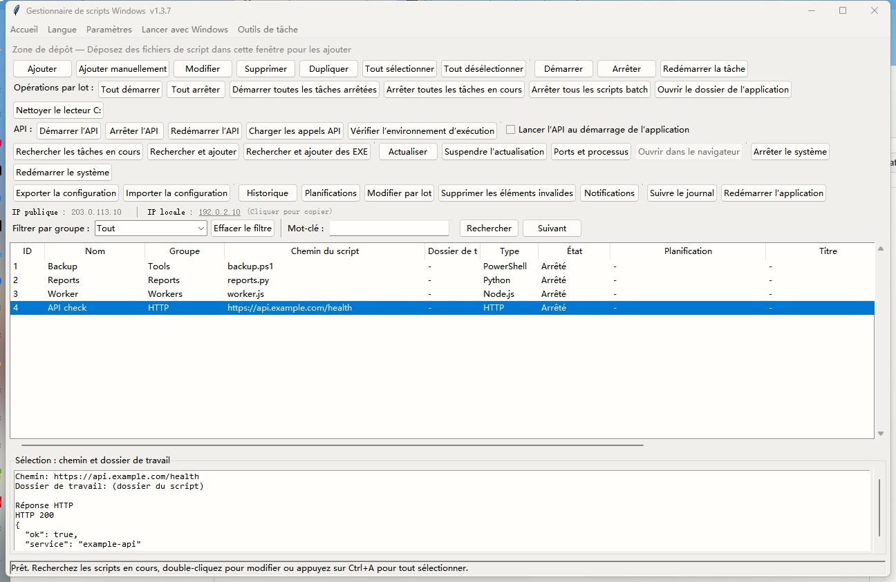

# WindowsBatchScriptManager · Français

[简体中文](README.zh-CN.md) · [English](README.md) · [繁體中文](README.zh-TW.md) · [日本語](README.ja-JP.md) · [한국어](README.ko-KR.md) · [Deutsch](README.de-DE.md) · [Français](README.fr-FR.md) · [Español](README.es-ES.md) · [Português (Brasil)](README.pt-BR.md) · [Русский](README.ru-RU.md)

Gérez les scripts batch, Python, Node.js et PowerShell sous Windows avec la planification, la file d’attente et l’API distante.

Pour utiliser Codex ou Claude Code à distance, activez SSH/SFTP dans WBSM sous Windows. Sous Linux et macOS, utilisez le service SSH existant sur le port 22 par défaut. [Configuration et exemples](README.md#ai-remote-access)

[Télécharger pour Windows](https://github.com/shellsec/WindowsBatchScriptManager/releases)

## Usages en entreprise et solutions

Deux usages indépendants : gérer les scripts Windows dans la durée et permettre la maintenance par IA via SSH/SFTP. Adapté aux petites équipes exploitant des machines existantes de scan, collecte, compilation ou sauvegarde.

- Environnement difficile à réinstaller : configurer les tâches et l’accès sur le Windows existant.
- Scripts, arguments et interpréteurs dispersés : centraliser les définitions, modèles, imports de dossiers et choix d’environnement.
- Planification, concurrence, relance et étapes suivantes : le gestionnaire en cours d’exécution s’en charge sans créer une tâche Windows pour chaque script.
- Sessions RDP répétées : Codex ou Claude Code utilise SSH et SFTP selon les droits du compte Windows.
- Diagnostic difficile : consulter les sorties enregistrées, l’historique et les réponses HTTP ; activer la journalisation des scripts compatibles.
- Risque de double lancement après mise à jour : ignorer les tâches de démarrage et vérifier l’identité des processus restaurés.
- Plusieurs machines : maintenance individuelle avec des alias SSH ; pas de console centrale de parc.

Planification, file d’attente et relance nécessitent le gestionnaire actif. OpenSSH est un service distinct ; une déconnexion de maintenance ne stoppe pas à elle seule les tâches gérées. Les commandes lancées directement par SSH dépendent de leur mode de démarrage. Les applications graphiques peuvent exiger un bureau interactif. Un processus présent ne prouve pas le bon fonctionnement métier ; ni audit complet ni récupération universelle ne sont garantis. Valider droits, mises à jour, récupération et fonctionnement prolongé avant production.

## MCP des tâches

Indépendant de SSH, MCP consulte, démarre, arrête et redémarre les tâches enregistrées. v1.3.13 ajoute `get_task_logs` (lecture seule, 100 lignes par défaut, au plus 1000 lignes sur les derniers 64 KiB) et `get_task_result` (dernière exécution enregistrée). Une absence de résultat ou de code de sortie ne signifie pas un succès ; l’historique n’est pas l’état en direct. Mettre à jour le script API et le gestionnaire. Les tâches locales et SSH ne nécessitent pas ce script. [Limites](docs/MCP_TASK_DIAGNOSTICS.md)

## Démarrage rapide

Pour utiliser l’application de bureau, lancez l’EXE autonome. Pour l’API distante, placez l’EXE et le script API dans le même dossier sur le serveur, installez les dépendances Python et démarrez le service. Conservez les fichiers JSON de configuration lors d’une mise à jour.

```powershell
python -m pip install fastapi "uvicorn[standard]"
python WindowsBatchScriptManager_api_server.py --host 0.0.0.0 --port 8765 --api-key "<API_KEY>"
```

Le premier choix du menu Langue suit le système, et le deuxième est English. Vous pouvez aussi choisir une langue manuellement.

## Nettoyer le lecteur C:

Le nettoyage de C: retire les fichiers `.tmp` / `.temp` identifiés sans limite d’âge, les miniatures, les caches de navigateurs et shaders pris en charge, les anciens journaux et les vidages mémoire, et vide le cache DNS. La Corbeille est conservée ; les chemins protégés et caches de navigateurs actifs sont ignorés. L’aperçu liste les emplacements connus, sans sélection initiale. Prefetch, points de restauration individuels et désactivation de la veille prolongée sont facultatifs. Le clic droit ouvre l’emplacement ou copie le chemin ; un message explique le fichier système masqué. Désactiver la veille prolongée exige les droits administrateur et désactive le démarrage rapide. Aucun fichier résiduel n’est supprimé de force ni compté comme espace libéré.



[API / MCP](docs/USER_GUIDE.en-US.md#remote-api-and-mcp) · [AGPL-3.0](LICENSE) · [NOTICE](NOTICE)


À partir de v1.3.13 : AGPL-3.0-only. L’usage commercial est autorisé ; redistribution et services réseau modifiés impliquent des obligations de fourniture du code source correspondant. Toute modification privée ne doit pas nécessairement être publiée sur GitHub. [Licence et dépendances](THIRD_PARTY_NOTICES.md)
