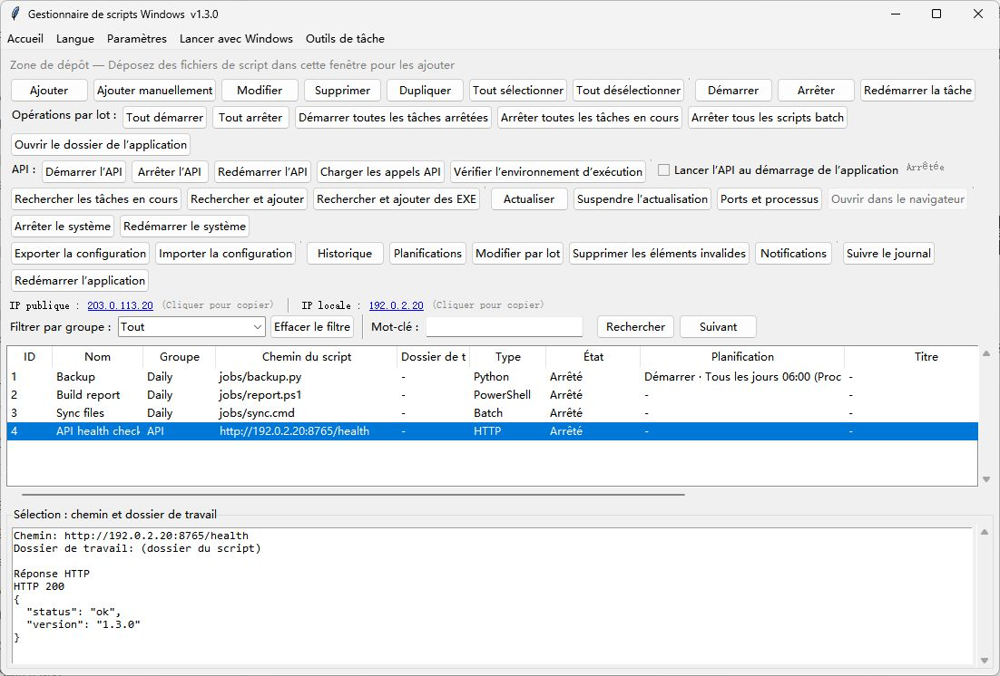

# WindowsBatchScriptManager · Français

[English](README.md) · [简体中文](README.zh-CN.md) · [繁體中文](README.zh-TW.md) · [日本語](README.ja-JP.md) · [한국어](README.ko-KR.md) · [Deutsch](README.de-DE.md) · [Français](README.fr-FR.md) · [Español](README.es-ES.md) · [Português (Brasil)](README.pt-BR.md) · [Русский](README.ru-RU.md)

Gérez les scripts batch, Python, Node.js et PowerShell sous Windows avec la planification, la file d’attente et l’API distante.

[Télécharger pour Windows](https://github.com/shellsec/WindowsBatchScriptManager/releases)
## Démarrage rapide

Pour utiliser l’application de bureau, lancez l’EXE autonome. Pour l’API distante, placez l’EXE et le script API dans le même dossier sur le serveur, installez les dépendances Python et démarrez le service. Conservez les fichiers JSON de configuration lors d’une mise à jour.

```powershell
python -m pip install fastapi "uvicorn[standard]"
python WindowsBatchScriptManager_api_server.py --host 0.0.0.0 --port 8765 --api-key "<API_KEY>"
```

Le premier choix du menu Langue suit le système, et le deuxième est English. Vous pouvez aussi choisir une langue manuellement.



[API / MCP](docs/USER_GUIDE.en-US.md#remote-api-and-mcp) · [Apache-2.0](LICENSE) · [NOTICE](NOTICE)
