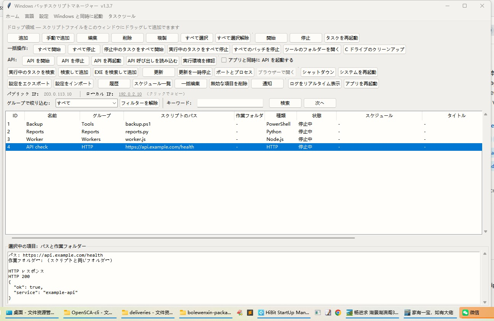

# WindowsBatchScriptManager · 日本語

[简体中文](README.zh-CN.md) · [English](README.md) · [繁體中文](README.zh-TW.md) · [日本語](README.ja-JP.md) · [한국어](README.ko-KR.md) · [Deutsch](README.de-DE.md) · [Français](README.fr-FR.md) · [Español](README.es-ES.md) · [Português (Brasil)](README.pt-BR.md) · [Русский](README.ru-RU.md)

Windows でバッチ、Python、Node.js、PowerShell のタスクを管理できます。スケジュール、実行キュー、リモート API に対応しています。

Codex や Claude Code でリモート操作するには、Windows では WBSM から SSH/SFTP を有効にします。Linux と macOS では既存の SSH サービス（既定ポート 22）を使います。[設定と使用例](README.md#ai-remote-access)

[Windows 版をダウンロード](https://github.com/shellsec/WindowsBatchScriptManager/releases)

## 企業での利用場面と解決方法

主な用途は Windows のスクリプトタスク管理と、SSH/SFTP による AI の遠隔保守です。それぞれ単独で利用でき、既存のスキャン・収集・ビルド・バックアップ用 PC を少人数で管理するチームに適しています。

- 再インストールが難しい業務 PC：既存の Windows 環境でタスクと接続を設定。
- スクリプト、引数、インタープリターが分散：設定を集約し、テンプレート、フォルダー取り込み、実行環境の選択を利用。
- 定期実行、同時実行制限、再起動、後続処理：起動中の管理アプリが制御し、個別の Windows タスク登録は不要。
- 保守のたびに RDP が必要：Codex や Claude Code が SSH でコマンド、SFTP で転送。操作範囲は Windows アカウントの権限に従います。
- 障害原因が分からない：記録済み出力、実行履歴、HTTP 応答をパネルで確認。対応するスクリプトはログの有効化が必要。
- 更新時の二重起動が心配：更新再起動では自動起動タスクをスキップし、復元時にプロセスの識別情報を確認。
- 複数 PC：SSH 別名で個別保守。集中管理画面はありません。

スケジュール、キュー、自動再起動には管理アプリの継続実行が必要です。OpenSSH は独立サービスで、保守接続の切断だけでは管理対象タスクは停止しません。SSH から直接起動したコマンドの寿命は起動方法によります。GUI には対話デスクトップが必要な場合があります。プロセス存在は業務正常の証明ではなく、完全な監査や全障害の自動復旧も保証しません。本番導入前に権限、更新・復旧、連続稼働を検証してください。

## タスク MCP

MCP は SSH 保守とは独立し、登録済みタスクの照会・開始・停止・再起動に使います。v1.3.13 で読み取り専用の `get_task_logs`（既定 100 行、最大 1000 行、末尾 64 KiB）と `get_task_result`（最新の記録済み実行結果）を追加。記録や終了コードがない場合は成功と見なしません。履歴は現在の状態とは異なります。API スクリプトと本体の両方を更新してください。ローカル管理と SSH に API は不要です。[制限事項](docs/MCP_TASK_DIAGNOSTICS.md)

## クイックスタート

デスクトップ版は単体の EXE を起動します。リモート API を使うには、サーバーの同じフォルダーに EXE と API スクリプトを置き、Python の依存パッケージをインストールしてサービスを起動します。更新時は既存の設定 JSON を保持してください。

```powershell
python -m pip install fastapi "uvicorn[standard]"
python WindowsBatchScriptManager_api_server.py --host 0.0.0.0 --port 8765 --api-key "<API_KEY>"
```

言語メニューの先頭は「システムに従う」、2 番目は English です。言語は手動でも選べます。

## C ドライブのクリーンアップ

C ドライブの既知の `.tmp` / `.temp`、サムネイル、対応ブラウザー・シェーダーのキャッシュ、古いタスクログ、クラッシュダンプを日数制限なしで削除し、DNS キャッシュを消去します。ごみ箱は保持し、保護パスと実行中ブラウザーのキャッシュはスキップします。ディスクのプレビューは既知の場所のみ表示し、初期選択はありません。Prefetch、個別の復元ポイント、休止状態の無効化は任意です。右クリックで場所表示・パスコピーができ、休止ファイルには非表示設定の案内があります。休止無効化には管理者権限が必要で、高速スタートアップも無効になります。残存ファイルは強制削除せず、解放済み容量にも算入しません。



[API / MCP](docs/USER_GUIDE.en-US.md#remote-api-and-mcp) · [AGPL-3.0](LICENSE) · [NOTICE](NOTICE)


v1.3.13 以降は AGPL-3.0-only です。商用利用は可能ですが、再配布と変更版のネットワーク提供には対応ソースの提供義務があります。私的な変更すべてを GitHub に公開する義務ではありません。[ライセンスと依存関係](THIRD_PARTY_NOTICES.md)
