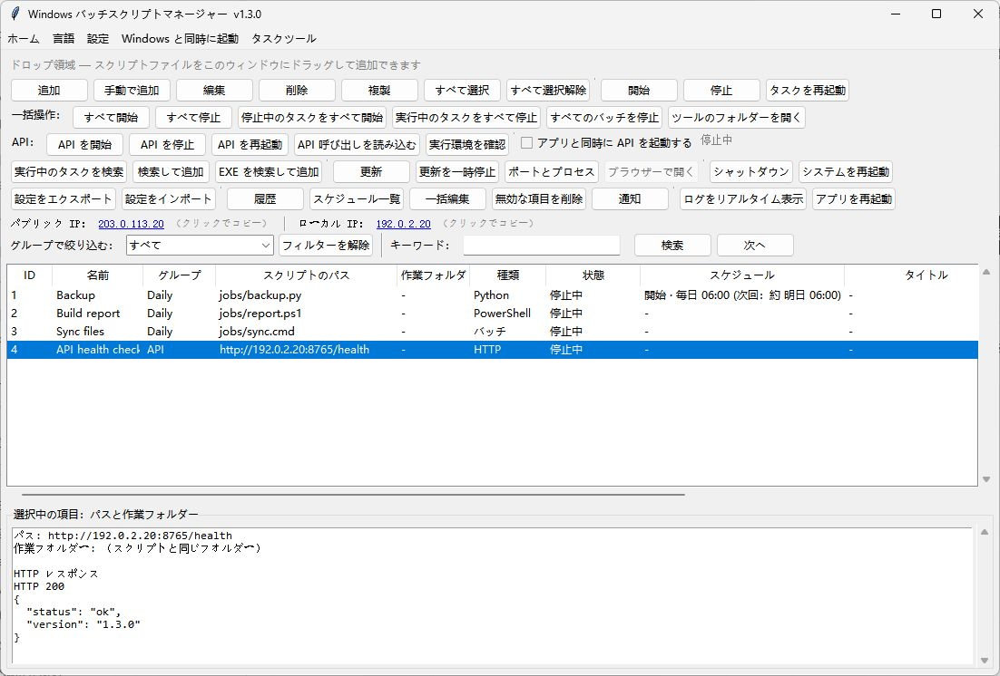

# WindowsBatchScriptManager · 日本語

[English](README.md) · [简体中文](README.zh-CN.md) · [繁體中文](README.zh-TW.md) · [日本語](README.ja-JP.md) · [한국어](README.ko-KR.md) · [Deutsch](README.de-DE.md) · [Français](README.fr-FR.md) · [Español](README.es-ES.md) · [Português (Brasil)](README.pt-BR.md) · [Русский](README.ru-RU.md)

Windows でバッチ、Python、Node.js、PowerShell のタスクを管理できます。スケジュール、実行キュー、リモート API に対応しています。

[Windows 版をダウンロード](https://github.com/shellsec/WindowsBatchScriptManager/releases)
## クイックスタート

デスクトップ版は単体の EXE を起動します。リモート API を使うには、サーバーの同じフォルダーに EXE と API スクリプトを置き、Python の依存パッケージをインストールしてサービスを起動します。更新時は既存の設定 JSON を保持してください。

```powershell
python -m pip install fastapi "uvicorn[standard]"
python WindowsBatchScriptManager_api_server.py --host 0.0.0.0 --port 8765 --api-key "<API_KEY>"
```

言語メニューの先頭は「システムに従う」、2 番目は English です。言語は手動でも選べます。



[API / MCP](docs/USER_GUIDE.en-US.md#remote-api-and-mcp) · [Apache-2.0](LICENSE) · [NOTICE](NOTICE)
