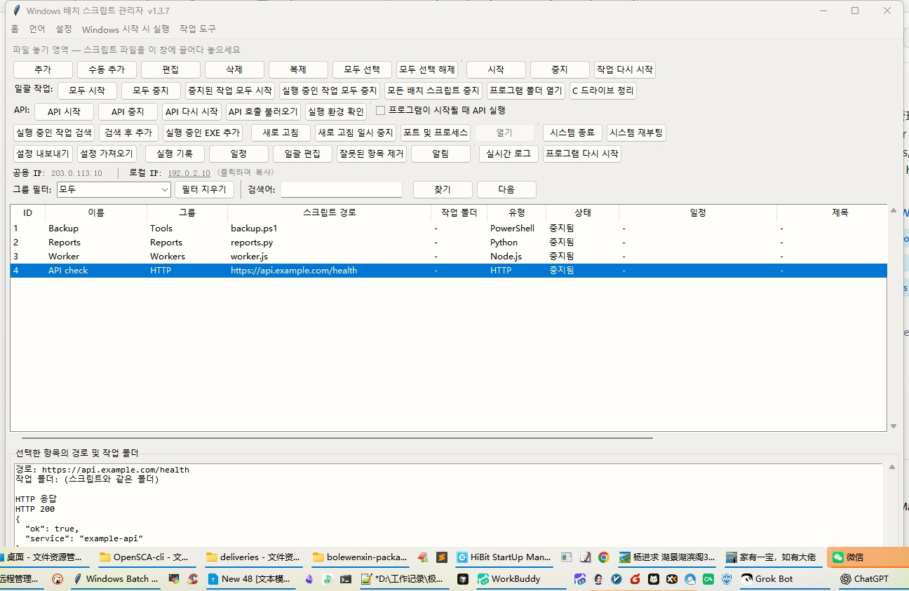

# WindowsBatchScriptManager · 한국어

[简体中文](README.zh-CN.md) · [English](README.md) · [繁體中文](README.zh-TW.md) · [日本語](README.ja-JP.md) · [한국어](README.ko-KR.md) · [Deutsch](README.de-DE.md) · [Français](README.fr-FR.md) · [Español](README.es-ES.md) · [Português (Brasil)](README.pt-BR.md) · [Русский](README.ru-RU.md)

Windows 배치, Python, Node.js, PowerShell 작업을 관리합니다. 일정, 실행 대기열, 원격 API를 지원합니다.

Codex 또는 Claude Code에서 원격으로 작업하려면 Windows에서는 WBSM으로 SSH/SFTP를 활성화합니다. Linux와 macOS에서는 기존 SSH 서비스(기본 포트 22)를 사용합니다. [설정과 사용 예](README.md#ai-remote-access)

[Windows용 다운로드](https://github.com/shellsec/WindowsBatchScriptManager/releases)

## 기업 사용 사례와 해결 방법

Windows 스크립트 작업 관리와 SSH/SFTP를 통한 AI 원격 유지보수가 두 가지 주요 용도이며 각각 독립적으로 사용할 수 있습니다. 기존 스캔·수집·빌드·백업 PC를 적은 인원으로 관리하는 팀에 적합합니다.

- 업무 환경 재설치가 어려움: 기존 Windows에서 작업과 접속을 설정합니다.
- 스크립트·인수·인터프리터가 흩어짐: 작업 설정을 모으고 템플릿, 폴더 가져오기, 실행 환경 선택을 사용합니다.
- 예약·동시 실행 제한·자동 재시작·후속 작업 필요: 실행 중인 관리자가 처리하며 작업마다 Windows 작업 스케줄러를 설정할 필요가 없습니다.
- 유지보수 때마다 RDP 접속: Codex 또는 Claude Code가 SSH 명령과 SFTP 전송을 사용하며 Windows 계정 권한을 따릅니다.
- 오류 원인 확인이 어려움: 패널에서 기록된 출력, 실행 이력, HTTP 응답을 확인합니다. 지원 스크립트는 로그 기록을 켜야 합니다.
- 업데이트 중 중복 실행 우려: 업데이트 재시작은 시작 작업을 건너뛰고 복원 시 프로세스 신원을 확인합니다.
- 여러 PC: SSH 별칭으로 개별 관리하며 중앙 다중 호스트 패널은 없습니다.

예약·큐·자동 재시작에는 관리자 프로세스가 계속 실행되어야 합니다. OpenSSH는 별도 서비스이며 유지보수 연결 해제 자체가 관리 작업을 중지하지 않습니다. SSH로 직접 시작한 명령의 수명은 시작 방식에 따라 다릅니다. GUI에는 대화형 데스크톱이 필요할 수 있습니다. 프로세스 존재가 업무 정상이나 완전한 감사·자동 복구를 보장하지 않습니다. 운영 배포 전에 권한, 업데이트 복구와 장기 실행을 검증하세요.

## 작업 MCP

MCP는 SSH 유지보수와 독립적이며 등록된 작업의 조회·시작·중지·재시작을 제공합니다. v1.3.13은 읽기 전용 `get_task_logs`(기본 100줄, 최대 1000줄 및 마지막 64 KiB)와 `get_task_result`(최근 기록된 실행 결과)를 추가합니다. 기록이나 종료 코드가 없다고 성공은 아닙니다. 이력은 실시간 상태와 다릅니다. API 스크립트와 관리자 본체를 모두 업데이트하세요. 로컬 관리와 SSH는 API 스크립트가 없어도 됩니다.[제한 사항](docs/MCP_TASK_DIAGNOSTICS.md)

## 빠른 시작

데스크톱에서는 단일 EXE를 실행하세요. 원격 API를 사용하려면 서버의 같은 폴더에 EXE와 API 스크립트를 두고 Python 종속 패키지를 설치한 뒤 서비스를 시작하세요. 업데이트할 때 기존 설정 JSON을 보존하세요.

```powershell
python -m pip install fastapi "uvicorn[standard]"
python WindowsBatchScriptManager_api_server.py --host 0.0.0.0 --port 8765 --api-key "<API_KEY>"
```

언어 메뉴의 첫 번째 항목은 시스템 언어, 두 번째 항목은 English입니다. 언어를 직접 선택할 수도 있습니다.

## C 드라이브 정리

C 드라이브의 식별된 `.tmp` / `.temp`, 썸네일, 지원 브라우저·셰이더 캐시, 이전 작업 로그, 충돌 덤프를 기간 제한 없이 정리하고 DNS 캐시를 비웁니다. 휴지통은 유지하고 보호된 경로와 실행 중 브라우저 캐시는 건너뜁니다. 디스크 미리보기는 알려진 위치만 표시하며 기본 선택은 없습니다. Prefetch, 개별 복원 지점, 최대 절전 모드 해제는 선택 사항입니다. 우클릭으로 위치 열기·경로 복사가 가능하며 절전 파일에는 숨김 안내가 표시됩니다. 최대 절전 해제에는 관리자 권한이 필요하고 빠른 시작도 해제됩니다. 남은 파일은 강제 삭제하거나 확보된 공간으로 계산하지 않습니다.



[API / MCP](docs/USER_GUIDE.en-US.md#remote-api-and-mcp) · [AGPL-3.0](LICENSE) · [NOTICE](NOTICE)


v1.3.13부터 AGPL-3.0-only를 적용합니다. 상업적 이용은 허용되며 재배포와 수정된 네트워크 서비스에는 해당 소스 제공 의무가 있습니다. 모든 개인 수정 사항을 GitHub에 공개해야 한다는 뜻은 아닙니다.[라이선스 및 의존성](THIRD_PARTY_NOTICES.md)
