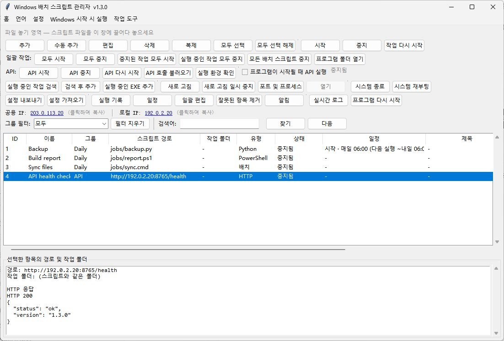

# WindowsBatchScriptManager · 한국어

[English](README.md) · [简体中文](README.zh-CN.md) · [繁體中文](README.zh-TW.md) · [日本語](README.ja-JP.md) · [한국어](README.ko-KR.md) · [Deutsch](README.de-DE.md) · [Français](README.fr-FR.md) · [Español](README.es-ES.md) · [Português (Brasil)](README.pt-BR.md) · [Русский](README.ru-RU.md)

Windows 배치, Python, Node.js, PowerShell 작업을 관리합니다. 일정, 실행 대기열, 원격 API를 지원합니다.

[Windows용 다운로드](https://github.com/shellsec/WindowsBatchScriptManager/releases)
## 빠른 시작

데스크톱에서는 단일 EXE를 실행하세요. 원격 API를 사용하려면 서버의 같은 폴더에 EXE와 API 스크립트를 두고 Python 종속 패키지를 설치한 뒤 서비스를 시작하세요. 업데이트할 때 기존 설정 JSON을 보존하세요.

```powershell
python -m pip install fastapi "uvicorn[standard]"
python WindowsBatchScriptManager_api_server.py --host 0.0.0.0 --port 8765 --api-key "<API_KEY>"
```

언어 메뉴의 첫 번째 항목은 시스템 언어, 두 번째 항목은 English입니다. 언어를 직접 선택할 수도 있습니다.

## C 드라이브 정리

v1.3.4에서는 도구 폴더 열기 버튼 옆의 C 드라이브 정리를 사용할 수 있습니다. 백그라운드에서 실행되며 단계별 결과가 아래 로그에 표시됩니다. C 드라이브의 사용자 및 시스템 임시 폴더에서 수정한 지 7일이 지난 `.tmp`와 `.temp` 파일, C 드라이브의 사용자 미리 보기 캐시를 삭제합니다. **C 드라이브 휴지통을 확인 없이 영구적으로 비우고** DNS 캐시를 지웁니다. 현재 권한으로 실행하며 Windows Update 캐시, Prefetch, 시스템 로그는 보존합니다.



[API / MCP](docs/USER_GUIDE.en-US.md#remote-api-and-mcp) · [Apache-2.0](LICENSE) · [NOTICE](NOTICE)
