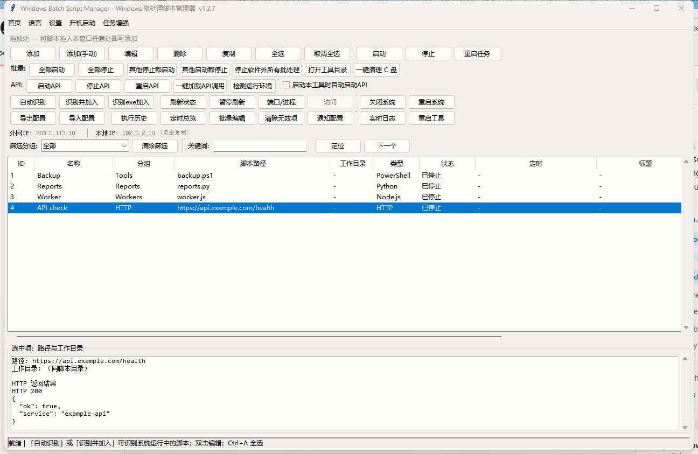
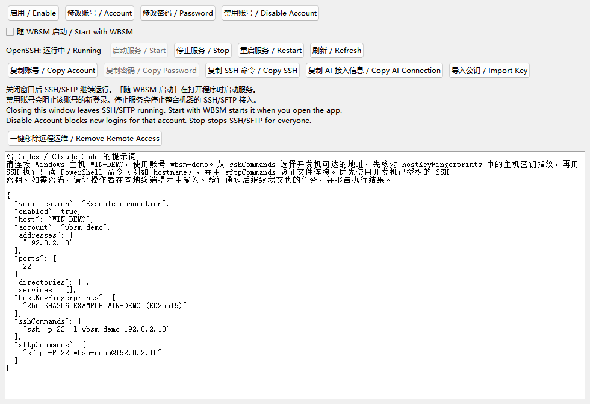

# WindowsBatchScriptManager

用一个 Windows 桌面工具管理批处理、Python、Node.js 和 PowerShell 脚本。支持定时、队列，以及通过 HTTP API 或 MCP 远程操作任务。

**让 Codex、Claude Code 直接操作 Windows 目标机。** 在 WBSM 中启用远程运维并复制接入信息，AI 就能通过 SSH 执行 PowerShell，通过 SFTP 上传和下载文件。

[](LICENSE)
[](https://github.com/shellsec/WindowsBatchScriptManager/releases/latest)

[简体中文](README.md) · [English](README.en-US.md) · [繁體中文](README.zh-TW.md) · [日本語](README.ja-JP.md) · [한국어](README.ko-KR.md) · [Deutsch](README.de-DE.md) · [Français](README.fr-FR.md) · [Español](README.es-ES.md) · [Português (Brasil)](README.pt-BR.md) · [Русский](README.ru-RU.md)

[下载 Windows 版](https://github.com/shellsec/WindowsBatchScriptManager/releases) · [使用手册](docs/USER_GUIDE.zh-CN.md) · [AI 远程运维](#ai-远程运维) · [API 与 MCP](docs/USER_GUIDE.zh-CN.md#远程-api-与-mcp)



## 适合哪些场景

两大用途：在 Windows 上管理持续运行的脚本任务，以及让 AI 通过 SSH/SFTP 部署和维护机器。两者可以独立使用。

| 你遇到的问题 | WBSM 如何帮助 |
| --- | --- |
| Windows 已经承担扫描、采集、构建等业务，现有环境不方便迁移或重装。 | 在现有 Windows 上集中管理脚本、配置远程接入。 |
| 脚本分散在不同目录，启动命令、参数和解释器容易忘记。 | 集中保存任务配置，支持模板、文件夹导入和每项任务的运行环境选择。 |
| 任务需要定时、限制并发、异常后拉起，或根据结果执行下一步。 | 由运行中的管理器提供定时、队列、保活和后续任务规则，无需逐项配置 Windows 任务计划程序。 |
| 每次部署、查日志和排错，都要登录远程桌面。 | 配置 OpenSSH 和专用账号，让 Codex、Claude Code 在账号权限范围内通过 SSH 执行命令、SFTP 传输文件。 |
| 多个控制台分散，任务失败后难找线索。 | 在面板查看已记录的输出、执行历史和 HTTP 返回结果；支持的脚本类型需要先开启日志记录。 |
| 希望 AI 操作面板中已经登记的任务。 | 可选 HTTP/MCP 服务提供任务列表、进程状态查询以及启停、重启接口。 |
| 更新重启管理器时，担心启动任务重复运行。 | 更新重启跳过“启动本工具时自动启动”的任务，恢复运行任务时核对保存的进程身份；不承诺所有系统或进程故障都能自动恢复。 |
| 多台 Windows 各自承担业务，希望按需远程维护。 | 每台独立运行管理器，通过 SSH 别名区分目标并分别维护；目前不提供集中多机面板。 |

**运行边界：**定时、队列和保活依赖管理器进程持续运行，脚本进程仍在并不代表调度也在继续。OpenSSH 作为独立服务运行，维护端断开本身不会停止管理器管理的任务；直接通过 SSH 启动的命令，其存活取决于具体会话和启动方式。必须操作图形界面的程序仍可能需要交互桌面。进程存在不等于业务健康，当前能力不代表已具备应用健康检查或完整 SSH 命令审计。

本地任务管理和 SSH/SFTP 接入不要求独立 API 脚本存在；HTTP API 和任务 MCP 服务需要 `WindowsBatchScriptManager_api_server.py` 及其 Python 依赖。[任务管理说明](docs/TASK_MANAGEMENT.md) · [远程接入说明](docs/WINDOWS_REMOTE_ACCESS.md)

## 企业使用场景

适合已有多台 Windows 业务机、维护人员有限的运维和研发团队，例如扫描机、采集机、构建机、定时数据处理和备份任务。保留现有系统与运行环境，本地集中管理每台机器的任务，需要部署、查日志和排错时再让 AI 通过 SSH 接入。

任务管理、SSH 维护与可选任务 MCP 是独立入口。目前不是集中多机运维平台，也不承诺无人值守下所有故障自动恢复。正式使用前，请在本单位环境验证权限、升级恢复和持续运行行为。

## 快速开始

1. 打开 [GitHub Releases](https://github.com/shellsec/WindowsBatchScriptManager/releases)，下载并解压 Windows ZIP。
2. 运行 `WindowsBatchScriptManager.exe`。桌面 EXE 自带 Python 运行库。
3. 点击「添加」选择脚本，再点击「启动」。Python、Node.js 等任务使用各自配置的解释器。

升级时请保留原有的 `WindowsBatchScriptManager_scripts.json` 和其他配置文件。

从 v1.3.7 起，可通过顶部「任务增强」右侧的「检查程序更新」手动检查 GitHub 新版。确认后，Windows 单文件版会下载并校验发行包，替换 EXE 后重启。简体和繁体中文界面按顺序尝试 gh-proxy.com、ghfast.top、gh.monlor.com 和 gh.acmsz.top 下载 ZIP，失败时回到 GitHub 直连。校验文件始终从 GitHub 获取。更新重启会跳过「启动本工具时自动启动」的任务。独立 API 脚本可按需单独更新。

## 核心功能

- 批量启停和重启脚本，查看端口、日志和执行历史。
- 多套 WBSM 同时运行时，API 启停按当前安装目录识别服务进程。
- API 未运行时也缓存状态检查。Windows OpenSSH 状态通过系统服务接口直接读取。
- 在执行历史选中一条记录，点击 **复制 AI 排障信息**，复制该次执行的退出码、状态和已关联的日志尾部。常见凭据格式会被遮盖，分享前可先核对。
- 从模板创建任务、按文件夹批量导入，选择 Python 虚拟环境、Conda 或 Node.js 版本。
- 设置定时和并发上限，根据执行结果触发后续任务。
- 执行 HTTP 请求，在下方详情区查看状态码和响应正文。
- 在 Windows 上启用 SSH/SFTP，复制 AI 接入信息，支持密码登录和导入开发机 SSH 公钥。
- 切换十种界面语言，菜单第一项为「跟随系统」。

定时、队列和后续任务由运行中的桌面程序管理。[任务管理指南](docs/TASK_MANAGEMENT.md)

## 一键清理 C 盘
从 v1.3.9 起，「一键清理 C 盘」清理识别出的 `.tmp` / `.temp` 临时文件，不设文件年龄限制，同时清理缩略图、支持的浏览器和着色器缓存、非运行任务日志及崩溃转储。结果显示在下方日志。受保护的程序和任务路径、正在运行的浏览器缓存会跳过，回收站保留。

「磁盘清理预览」列出本地固定磁盘上当前用户的已知缓存位置，不遍历任意目录，默认不勾选。Prefetch、单独的系统还原点和关闭休眠作为可选项目，确认前请查看删除影响。右键可定位文件或目录、复制路径；还原点不支持这些操作。关闭休眠需要管理员权限，也会关闭快速启动。若 Windows 仍保留 `hiberfil.sys`，程序会报错且不计入释放空间，不强制删除该文件。

要手动关闭休眠，在 **磁盘清理预览** 中右键休眠项，选择 **复制关闭休眠命令**。在开始菜单搜索 **Windows PowerShell**，右键选择 **以管理员身份运行**，在权限提示中点 **是**。确认窗口标题为 **管理员：Windows PowerShell**，把三行命令粘贴到 `PS>` 提示符后按回车。

```powershell
powercfg.exe /hibernate off
cmd.exe /d /c 'del /f /q /a "%SystemDrive%\hiberfil.sys"'
Get-Item -Force -LiteralPath "$env:SystemDrive\hiberfil.sys"
```

第一行关闭休眠和快速启动，第二行尝试强制删除残留的休眠文件，第三行检查文件。提示「找不到路径」表示该文件已移除。

## AI 远程运维

| 目标系统 | 接入方式 |
| --- | --- |
| **Windows** | 在 WBSM 中打开 **远程运维 → 启用**，确认管理员授权，一键配置 OpenSSH Server 和专用普通账号。离线版可使用随附安装包。启用后点击 **复制 AI 接入信息**，交给开发机上的 Codex 或 Claude Code。 |
| **Linux / macOS** | 直接使用目标机已启用的 SSH/SFTP，默认端口为 **22**。无需安装 WBSM 或额外适配。目标机使用自定义端口时，按实际端口连接。 |



- **远程部署**：在开发机改好代码后，通过 SFTP 上传 Python 脚本或 EXE，再通过 SSH 在目标机启动并检查健康端点。
- **排障和修改**：查询进程、下载可读日志、替换可写目录里的脚本，或检查目标机是否能运行 Python、Git 和 Docker。
- **重复连接**：在目标机导入开发机的 SSH 公钥后，可以免密登录。文件访问和命令执行范围由目标机账号权限决定。

远程运维使用标准 SSH/SFTP 命令。下方的 HTTP API 和 MCP 继续用于查询、启动和停止 WBSM 中已配置的任务。 [远程运维配置与验收](docs/WINDOWS_REMOTE_ACCESS.md)

## 远程 API 与 MCP

在服务器上把 `WindowsBatchScriptManager.exe` 和 `WindowsBatchScriptManager_api_server.py` 放在同一个目录。API 服务需要服务器上的 Python 和以下依赖。允许其他机器访问前，请设置专用密钥。

安装依赖后，可在目标机主界面 **API / MCP** 区域点击 **启动 API / MCP**。运行状态会显示 MCP 地址，可点 **复制 MCP 地址**。找不到脚本或启动失败时，先检查文件位置和 **检测运行环境** 的结果。也可以从 PowerShell 手动启动。

```powershell
python -m pip install fastapi "uvicorn[standard]"
python WindowsBatchScriptManager_api_server.py --host 0.0.0.0 --port 8765 --api-key "<你的密钥>"
```

HTTP 请求带上 `X-API-Key`。MCP 地址为 `http://<服务器地址>:8765/mcp`。例如，桌面端的 HTTP 任务可发送 `POST /start?id=10` 启动服务器上的任务 10。[API 与 MCP 参考](docs/USER_GUIDE.zh-CN.md#远程-api-与-mcp)

v1.3.13 新增只读 MCP 工具 `get_task_logs`（日志查询）和 `get_task_result`（执行记录查询），使用前需同时更新 API 脚本和主程序源码/EXE。[查询方式与限制](docs/MCP_TASK_DIAGNOSTICS.md)

## 文档

- [命令行与自动化](docs/USER_GUIDE.zh-CN.md#命令行cli)
- [Windows、macOS 和 Linux 源码运行](docs/USER_GUIDE.zh-CN.md#运行方式)
- [Windows 打包说明](PYINSTALLER.md)
- [贡献指南](CONTRIBUTING.md) · [AGPL-3.0 许可证](LICENSE) · [版权声明](NOTICE)

## 支持项目

[爱发电](https://ifdian.net/a/shellsec) · [aiv123.com](https://aiv123.com/) · [ofox.ai](https://ofox.io/x/aiv123) · [TOKEN2ROI（AI 代充）](https://token2roi.com/)


从 v1.3.13 起使用 AGPL-3.0-only。允许商用；再分发和修改版网络部署须履行对应源码提供义务。仅内部修改并不等于必须公开到 GitHub。[许可与依赖说明](THIRD_PARTY_NOTICES.md)。
