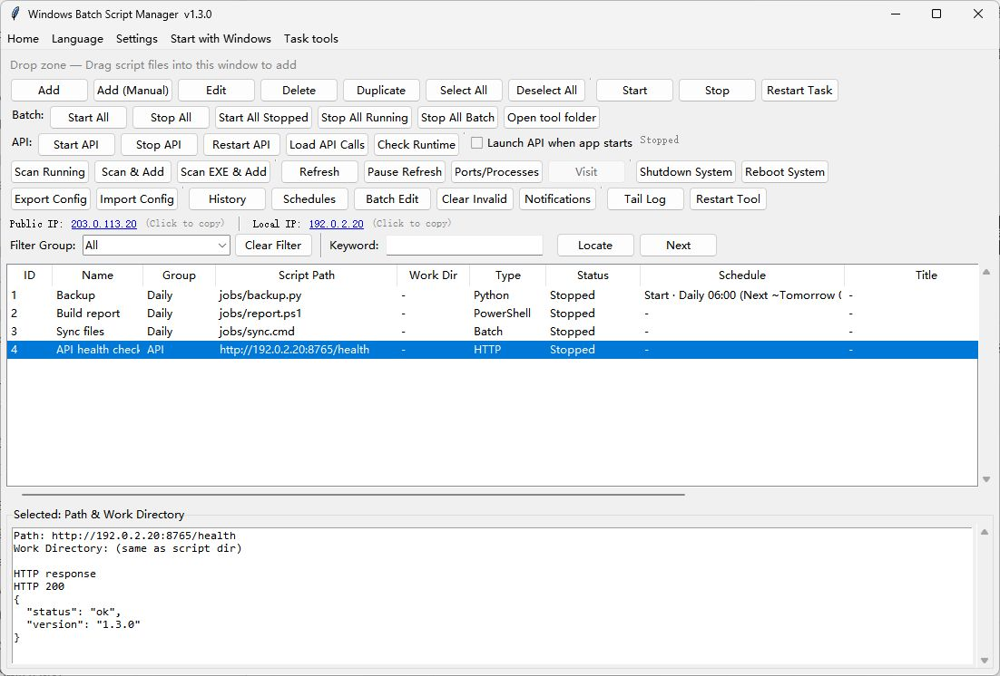

# WindowsBatchScriptManager

Manage batch, Python, Node.js, and PowerShell tasks from a Windows desktop app. Schedule jobs, queue runs, and control tasks remotely through HTTP or MCP.

[](LICENSE)
[](https://github.com/shellsec/WindowsBatchScriptManager/releases/latest)

[English](README.md) · [简体中文](README.zh-CN.md) · [繁體中文](README.zh-TW.md) · [日本語](README.ja-JP.md) · [한국어](README.ko-KR.md) · [Deutsch](README.de-DE.md) · [Français](README.fr-FR.md) · [Español](README.es-ES.md) · [Português (Brasil)](README.pt-BR.md) · [Русский](README.ru-RU.md)

[Download for Windows](https://github.com/shellsec/WindowsBatchScriptManager/releases) · [User guide](docs/USER_GUIDE.en-US.md) · [API and MCP](docs/USER_GUIDE.en-US.md#remote-api-and-mcp)



## Quick start

1. Open [GitHub Releases](https://github.com/shellsec/WindowsBatchScriptManager/releases) and extract the Windows ZIP.
2. Run `WindowsBatchScriptManager.exe`. The desktop EXE includes its Python runtime.
3. Select **Add**, choose a script, then select **Start**. Python, Node.js, and other tasks use their configured interpreters.

When upgrading, keep your existing `WindowsBatchScriptManager_scripts.json` and other configuration files.

## What you can do

- Start, stop, and restart tasks in groups. View ports, logs, and execution history.
- Create tasks from templates, import a folder, or choose a Python virtual environment, Conda environment, or Node.js version.
- Set schedules, limit concurrent runs, and trigger follow-up tasks based on success or failure.
- Run HTTP tasks and inspect the status code and response body in the details pane.
- Switch among ten interface languages. The first option follows the system language.

Schedules, queues, and follow-up tasks run while the desktop app is open. [Task management guide](docs/TASK_MANAGEMENT.md)

## C: drive cleanup

In v1.3.4, **Clean up C: drive** sits next to **Open tool folder**. It runs in the background and shows each result in the lower pane. It removes `.tmp` and `.temp` files last modified more than seven days ago from the current user’s and Windows’ temporary directories on C:, clears the current user’s thumbnail cache on C:, **permanently empties the C: Recycle Bin without confirmation**, and flushes DNS. It uses the current permissions and keeps the Windows Update cache, Prefetch, and system logs.

## Remote API and MCP

On the server, keep `WindowsBatchScriptManager.exe` and `WindowsBatchScriptManager_api_server.py` in the same directory. The API server needs Python and the packages below. Choose a private API key before making the service reachable from another machine.

```powershell
python -m pip install fastapi "uvicorn[standard]"
python WindowsBatchScriptManager_api_server.py --host 0.0.0.0 --port 8765 --api-key "<your-key>"
```

Use the `X-API-Key` header for HTTP requests. The MCP endpoint is `http://<server>:8765/mcp`. For example, a desktop HTTP task can send `POST /start?id=10` to start task 10 on the server. [API and MCP reference](docs/USER_GUIDE.en-US.md#remote-api-and-mcp)

## Documentation

- [CLI and automation](docs/USER_GUIDE.en-US.md#command-line-cli)
- [Run from source on Windows, macOS, or Linux](docs/USER_GUIDE.en-US.md#how-to-run)
- [Build the Windows EXE](PYINSTALLER.md)
- [Contributing](CONTRIBUTING.md) · [Apache-2.0 license](LICENSE) · [Notices](NOTICE)

## Support the project

[Sponsor on Afdian](https://ifdian.net/a/shellsec) · [aiv123.com](https://aiv123.com/) · [ofox.ai](https://ofox.io/x/aiv123)
