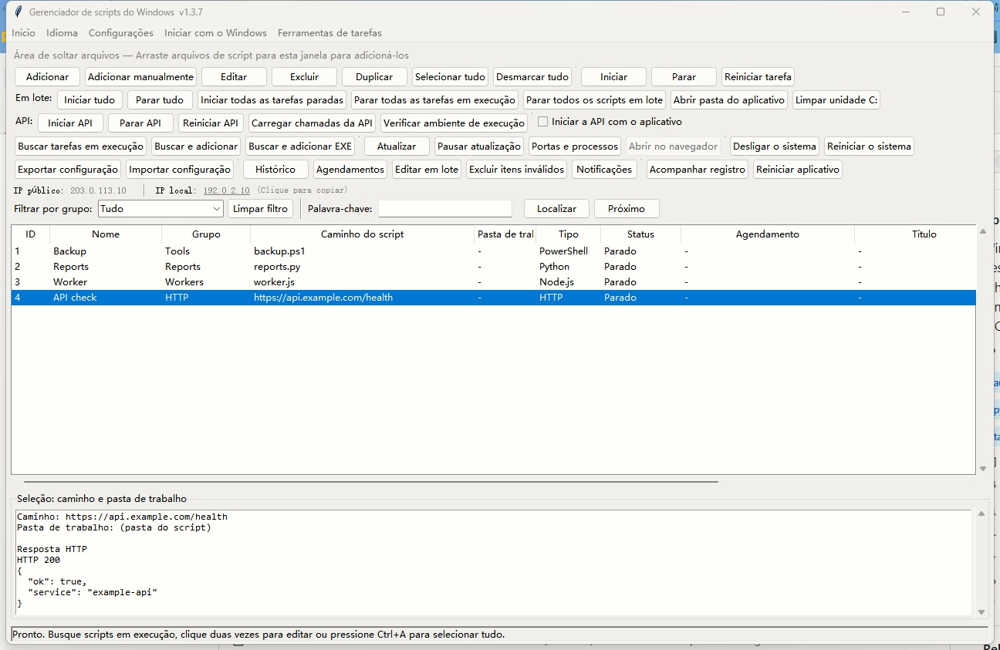

# WindowsBatchScriptManager · Português (Brasil)

[English](README.md) · [简体中文](README.zh-CN.md) · [繁體中文](README.zh-TW.md) · [日本語](README.ja-JP.md) · [한국어](README.ko-KR.md) · [Deutsch](README.de-DE.md) · [Français](README.fr-FR.md) · [Español](README.es-ES.md) · [Português (Brasil)](README.pt-BR.md) · [Русский](README.ru-RU.md)

Gerencie scripts em lote, Python, Node.js e PowerShell no Windows com agendamento, fila de execução e API remota.

Para usar Codex ou Claude Code remotamente, habilite SSH/SFTP no WBSM no Windows. No Linux e no macOS, use o serviço SSH existente, com a porta 22 por padrão. [Configuração e exemplos](README.md#ai-remote-access)

[Baixar para Windows](https://github.com/shellsec/WindowsBatchScriptManager/releases)

## Cenários empresariais e soluções

Dois usos independentes: gerenciar tarefas de scripts no Windows e realizar manutenção por IA via SSH/SFTP. Para equipes pequenas com máquinas existentes de varredura, coleta, compilação ou backup.

- Ambiente que não pode ser reinstalado facilmente: configurar tarefas e acesso no Windows existente.
- Scripts, argumentos e interpretadores espalhados: reunir configurações, modelos, importação de pastas e seleção do ambiente.
- Agendamento, concorrência, reinício e etapas seguintes: o gerenciador ativo controla tudo sem criar uma tarefa do Windows por script.
- Acesso RDP repetitivo: Codex ou Claude Code usa comandos SSH e arquivos SFTP conforme as permissões da conta Windows.
- Diagnóstico difícil: consultar saída gravada, histórico e respostas HTTP; habilitar logs nos scripts compatíveis.
- Início duplicado na atualização: ignorar tarefas de inicialização e verificar identidades dos processos restaurados.
- Várias máquinas: manter separadamente com aliases SSH; não há painel central de frota.

Agendamentos, filas e reinícios automáticos exigem o gerenciador em execução. OpenSSH é um serviço separado; desconectar a manutenção não interrompe por si só as tarefas gerenciadas. Comandos iniciados diretamente por SSH dependem do modo de inicialização. Aplicativos gráficos podem exigir uma área de trabalho interativa. Um processo ativo não comprova a saúde da aplicação; não há promessa de auditoria completa ou recuperação de toda falha. Valide permissões, atualização, recuperação e execução prolongada antes da produção.

## MCP de tarefas

O MCP é independente do SSH e consulta, inicia, para e reinicia tarefas cadastradas. v1.3.13 adiciona `get_task_logs` (somente leitura, 100 linhas por padrão, até 1000 linhas dos últimos 64 KiB) e `get_task_result` (última execução registrada). Ausência de registro ou código de saída não significa sucesso; histórico não é estado ao vivo. Atualize o script API e o gerenciador. Tarefas locais e SSH não dependem do script API. [Limitações](docs/MCP_TASK_DIAGNOSTICS.md)

## Início rápido

Para usar o aplicativo de desktop, execute o EXE independente. Para a API remota, coloque o EXE e o script da API na mesma pasta do servidor, instale as dependências do Python e inicie o serviço. Preserve os arquivos JSON de configuração ao atualizar.

```powershell
python -m pip install fastapi "uvicorn[standard]"
python WindowsBatchScriptManager_api_server.py --host 0.0.0.0 --port 8765 --api-key "<API_KEY>"
```

A primeira opção do menu de idiomas segue o sistema. A segunda é English. Também é possível escolher o idioma manualmente.

## Limpar a unidade C:

A limpeza de C: remove `.tmp` / `.temp` identificados sem limite de idade, miniaturas, caches de navegadores e shaders compatíveis, logs antigos e despejos de falha, e limpa DNS. A Lixeira é mantida; caminhos protegidos e caches de navegadores ativos são ignorados. A prévia lista locais conhecidos sem seleção inicial. Prefetch, pontos de restauração individuais e desativar hibernação são opcionais. O botão direito localiza ou copia o caminho; o arquivo de hibernação recebe um aviso de arquivo oculto. Desativar exige administrador e também desativa Inicialização Rápida. Arquivos restantes não são excluídos à força nem contados como espaço liberado.



[API / MCP](docs/USER_GUIDE.en-US.md#remote-api-and-mcp) · [AGPL-3.0](LICENSE) · [NOTICE](NOTICE)


Desde v1.3.13: AGPL-3.0-only. Uso comercial é permitido; redistribuição e serviços de rede modificados têm obrigações de fornecer o código-fonte correspondente. Nem toda alteração privada precisa ser publicada no GitHub. [Licença e dependências](THIRD_PARTY_NOTICES.md)
