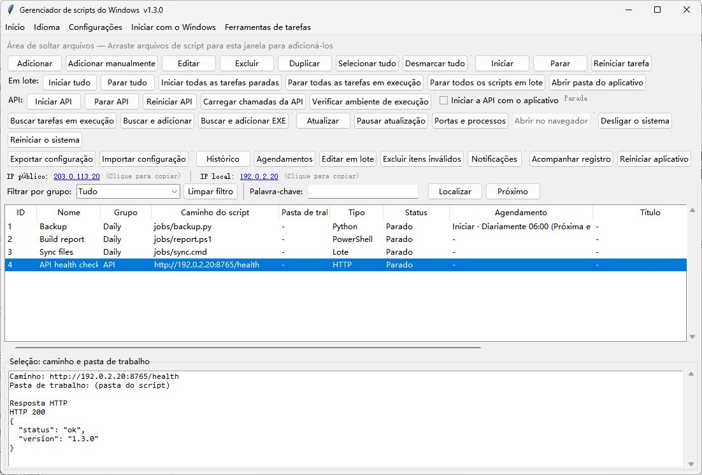

# WindowsBatchScriptManager · Português (Brasil)

[English](README.md) · [简体中文](README.zh-CN.md) · [繁體中文](README.zh-TW.md) · [日本語](README.ja-JP.md) · [한국어](README.ko-KR.md) · [Deutsch](README.de-DE.md) · [Français](README.fr-FR.md) · [Español](README.es-ES.md) · [Português (Brasil)](README.pt-BR.md) · [Русский](README.ru-RU.md)

Gerencie scripts em lote, Python, Node.js e PowerShell no Windows com agendamento, fila de execução e API remota.

[Baixar para Windows](https://github.com/shellsec/WindowsBatchScriptManager/releases)
## Início rápido

Para usar o aplicativo de desktop, execute o EXE independente. Para a API remota, coloque o EXE e o script da API na mesma pasta do servidor, instale as dependências do Python e inicie o serviço. Preserve os arquivos JSON de configuração ao atualizar.

```powershell
python -m pip install fastapi "uvicorn[standard]"
python WindowsBatchScriptManager_api_server.py --host 0.0.0.0 --port 8765 --api-key "<API_KEY>"
```

A primeira opção do menu de idiomas segue o sistema. A segunda é English. Também é possível escolher o idioma manualmente.



[API / MCP](docs/USER_GUIDE.en-US.md#remote-api-and-mcp) · [Apache-2.0](LICENSE) · [NOTICE](NOTICE)
