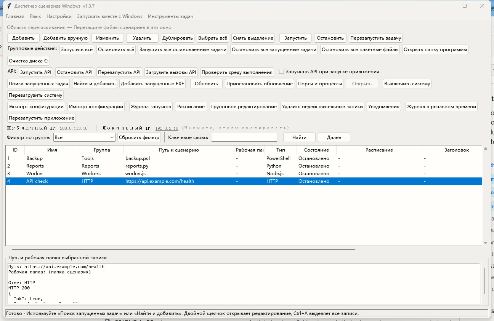

# WindowsBatchScriptManager · Русский

[English](README.md) · [简体中文](README.zh-CN.md) · [繁體中文](README.zh-TW.md) · [日本語](README.ja-JP.md) · [한국어](README.ko-KR.md) · [Deutsch](README.de-DE.md) · [Français](README.fr-FR.md) · [Español](README.es-ES.md) · [Português (Brasil)](README.pt-BR.md) · [Русский](README.ru-RU.md)

Управляйте пакетными файлами, сценариями Python, Node.js и PowerShell в Windows. Доступны расписание, очередь выполнения и удалённый API.

Для удалённой работы в Codex или Claude Code включите SSH/SFTP в WBSM на Windows. В Linux и macOS используйте имеющуюся службу SSH, по умолчанию на порту 22. [Настройка и примеры](README.md#ai-remote-access)

[Скачать для Windows](https://github.com/shellsec/WindowsBatchScriptManager/releases)

## Корпоративные сценарии и решения

Два независимых применения: управление скриптовыми задачами Windows и обслуживание с помощью ИИ через SSH/SFTP. Для небольших команд с существующими машинами сканирования, сбора данных, сборки или резервного копирования.

- Сложно переустановить рабочую среду: настройка задач и доступа на существующей Windows.
- Скрипты, аргументы и интерпретаторы разбросаны: единые настройки, шаблоны, импорт папок и выбор среды.
- Нужны расписания, ограничение параллелизма, перезапуск и следующие шаги: работающий менеджер выполняет их без отдельной задачи Windows для каждого скрипта.
- Постоянные подключения RDP: Codex или Claude Code использует SSH и SFTP в пределах прав учётной записи Windows.
- Сложно найти причину сбоя: сохранённый вывод, история и HTTP-ответы в панели; запись логов нужно включить.
- Повторный запуск при обновлении: пропуск стартовых задач и проверка идентичности процессов при восстановлении.
- Несколько машин: отдельное обслуживание по SSH-псевдонимам; центральной панели парка нет.

Расписания, очередь и автоматический перезапуск требуют работающего менеджера. OpenSSH — отдельная служба; разрыв соединения обслуживания сам по себе не останавливает управляемые задачи. Жизненный цикл команд, запущенных непосредственно по SSH, зависит от способа запуска. Для GUI может требоваться интерактивный рабочий стол. Наличие процесса не доказывает исправность приложения; полный аудит и восстановление любых сбоев не обещаются. До промышленного внедрения проверьте права, обновление, восстановление и длительную работу.

## MCP задач

MCP независим от SSH и позволяет просматривать, запускать, останавливать и перезапускать зарегистрированные задачи. В v1.3.13 добавлены инструменты чтения `get_task_logs` (по умолчанию 100, максимум 1000 строк из последних 64 KiB) и `get_task_result` (последний записанный результат). Отсутствие записи или кода выхода не означает успех; история не равна текущему состоянию. Обновите API-скрипт и менеджер вместе. Локальные задачи и SSH не требуют API-скрипта. [Ограничения](docs/MCP_TASK_DIAGNOSTICS.md)

## Быстрый старт

Для настольного приложения запустите отдельный EXE. Для удалённого API поместите EXE и скрипт API в одну папку на сервере, установите зависимости Python и запустите сервис. При обновлении сохраните существующие файлы конфигурации JSON.

```powershell
python -m pip install fastapi "uvicorn[standard]"
python WindowsBatchScriptManager_api_server.py --host 0.0.0.0 --port 8765 --api-key "<API_KEY>"
```

Первый пункт меню языка использует язык системы, второй — English. Язык также можно выбрать вручную.

## Очистка диска C:

Очистка C: удаляет распознанные `.tmp` / `.temp` без ограничения возраста, миниатюры, поддерживаемые кеши браузеров и шейдеров, старые логи и дампы, а также очищает DNS. Корзина сохраняется; защищённые пути и кеши работающих браузеров пропускаются. Предпросмотр показывает известные расположения без начального выбора. Prefetch, отдельные точки восстановления и отключение гибернации выбираются отдельно. Правый щелчок открывает расположение или копирует путь; для файла гибернации показывается пояснение о скрытом файле. Отключение требует администратора и отключает быстрый запуск. Остаточные файлы не удаляются принудительно и не учитываются как освобождённое место.



[API / MCP](docs/USER_GUIDE.en-US.md#remote-api-and-mcp) · [AGPL-3.0](LICENSE) · [NOTICE](NOTICE)


С v1.3.13 действует AGPL-3.0-only. Коммерческое использование разрешено; распространение и изменённые сетевые службы требуют предоставления соответствующего исходного кода по условиям лицензии. Это не означает публикацию любых частных изменений на GitHub. [Лицензии и зависимости](THIRD_PARTY_NOTICES.md)
