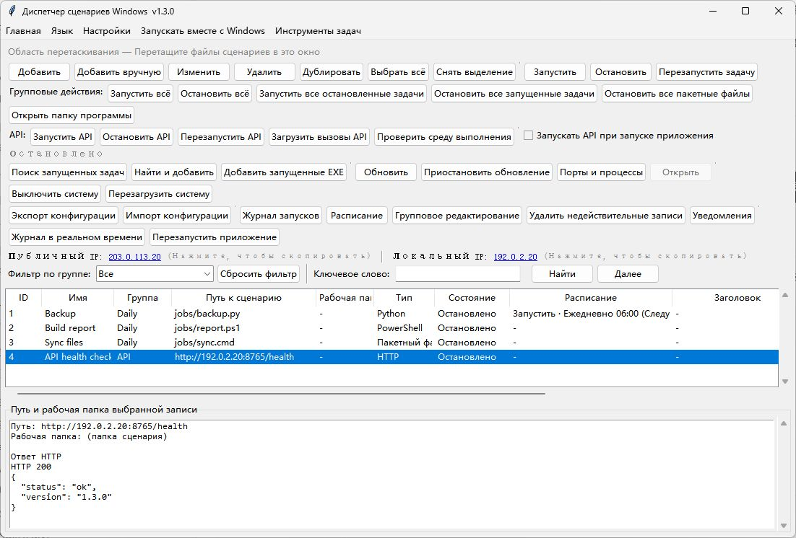

# WindowsBatchScriptManager · Русский

[English](README.md) · [简体中文](README.zh-CN.md) · [繁體中文](README.zh-TW.md) · [日本語](README.ja-JP.md) · [한국어](README.ko-KR.md) · [Deutsch](README.de-DE.md) · [Français](README.fr-FR.md) · [Español](README.es-ES.md) · [Português (Brasil)](README.pt-BR.md) · [Русский](README.ru-RU.md)

Управляйте пакетными файлами, сценариями Python, Node.js и PowerShell в Windows. Доступны расписание, очередь выполнения и удалённый API.

[Скачать для Windows](https://github.com/shellsec/WindowsBatchScriptManager/releases)
## Быстрый старт

Для настольного приложения запустите отдельный EXE. Для удалённого API поместите EXE и скрипт API в одну папку на сервере, установите зависимости Python и запустите сервис. При обновлении сохраните существующие файлы конфигурации JSON.

```powershell
python -m pip install fastapi "uvicorn[standard]"
python WindowsBatchScriptManager_api_server.py --host 0.0.0.0 --port 8765 --api-key "<API_KEY>"
```

Первый пункт меню языка использует язык системы, второй — English. Язык также можно выбрать вручную.

## Очистка диска C:

В версии 1.3.4 кнопка очистки находится рядом с кнопкой открытия папки программы. Очистка выполняется в фоновом режиме, а результаты отображаются в журнале внизу окна. Удаляются файлы `.tmp` и `.temp`, изменённые более семи дней назад, из временных папок пользователя и системы на диске C:, а также кэш эскизов пользователя на C:. Программа **без подтверждения очищает корзину диска C: без возможности восстановления** и сбрасывает кэш DNS. Используются текущие права доступа, кэш Центра обновления Windows, Prefetch и системные журналы сохраняются.



[API / MCP](docs/USER_GUIDE.en-US.md#remote-api-and-mcp) · [Apache-2.0](LICENSE) · [NOTICE](NOTICE)
