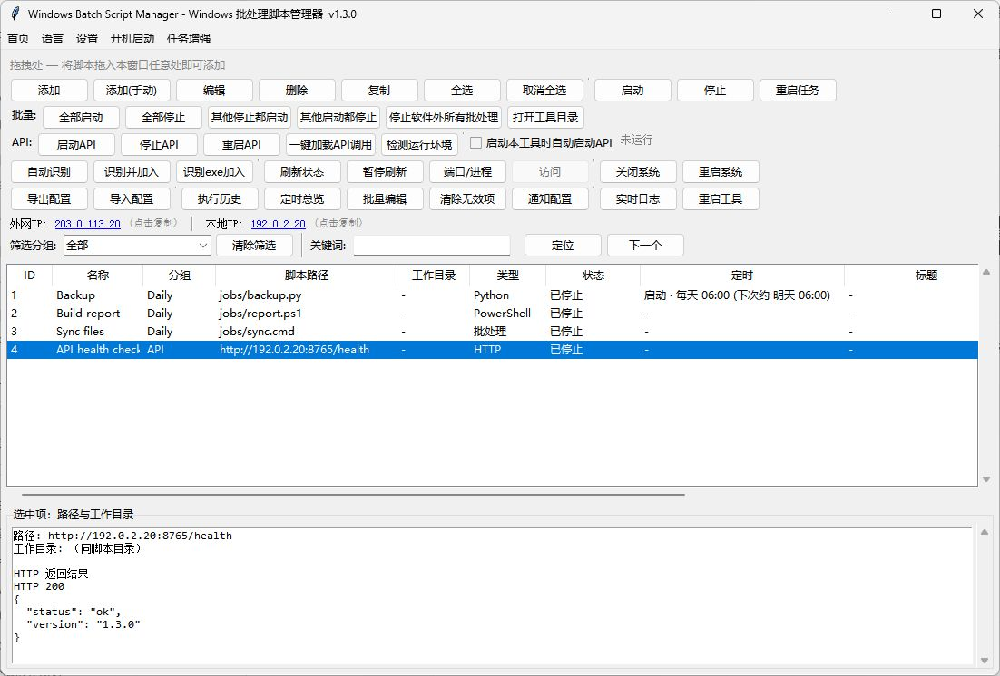

# WindowsBatchScriptManager

用一个 Windows 桌面工具管理批处理、Python、Node.js 和 PowerShell 脚本。支持定时、队列，以及通过 HTTP API 或 MCP 远程操作任务。

[](LICENSE)
[](version.py)

[English](README.md) · [简体中文](README.zh-CN.md) · [繁體中文](README.zh-TW.md) · [日本語](README.ja-JP.md) · [한국어](README.ko-KR.md) · [Deutsch](README.de-DE.md) · [Français](README.fr-FR.md) · [Español](README.es-ES.md) · [Português (Brasil)](README.pt-BR.md) · [Русский](README.ru-RU.md)

[下载 Windows 版](https://github.com/shellsec/WindowsBatchScriptManager/releases) · [使用手册](docs/USER_GUIDE.zh-CN.md) · [API 与 MCP](docs/USER_GUIDE.zh-CN.md#远程-api-与-mcp)



## 快速开始

1. 打开 [GitHub Releases](https://github.com/shellsec/WindowsBatchScriptManager/releases)，下载并解压 Windows ZIP。
2. 运行 `WindowsBatchScriptManager.exe`。桌面 EXE 自带 Python 运行库。
3. 点击「添加」选择脚本，再点击「启动」。Python、Node.js 等任务使用各自配置的解释器。

升级时请保留原有的 `WindowsBatchScriptManager_scripts.json` 和其他配置文件。

## 核心功能

- 批量启停和重启脚本，查看端口、日志和执行历史。
- 从模板创建任务、按文件夹批量导入，选择 Python 虚拟环境、Conda 或 Node.js 版本。
- 设置定时和并发上限，根据执行结果触发后续任务。
- 执行 HTTP 请求，在下方详情区查看状态码和响应正文。
- 切换十种界面语言，菜单第一项为「跟随系统」。

定时、队列和后续任务由运行中的桌面程序管理。[任务管理指南](docs/TASK_MANAGEMENT.md)

## 远程 API 与 MCP

在服务器上把 `WindowsBatchScriptManager.exe` 和 `WindowsBatchScriptManager_api_server.py` 放在同一个目录。API 服务需要服务器上的 Python 和以下依赖。允许其他机器访问前，请设置专用密钥。

```powershell
python -m pip install fastapi "uvicorn[standard]"
python WindowsBatchScriptManager_api_server.py --host 0.0.0.0 --port 8765 --api-key "<你的密钥>"
```

HTTP 请求带上 `X-API-Key`。MCP 地址为 `http://<服务器地址>:8765/mcp`。例如，桌面端的 HTTP 任务可发送 `POST /start?id=10` 启动服务器上的任务 10。[API 与 MCP 参考](docs/USER_GUIDE.zh-CN.md#远程-api-与-mcp)

## 文档

- [命令行与自动化](docs/USER_GUIDE.zh-CN.md#命令行cli)
- [Windows、macOS 和 Linux 源码运行](docs/USER_GUIDE.zh-CN.md#运行方式)
- [Windows 打包说明](PYINSTALLER.md)
- [贡献指南](CONTRIBUTING.md) · [Apache-2.0 许可证](LICENSE) · [版权声明](NOTICE)

## 支持项目

[爱发电](https://ifdian.net/a/shellsec) · [aiv123.com](https://aiv123.com/) · [ofox.ai](https://ofox.io/x/aiv123)
