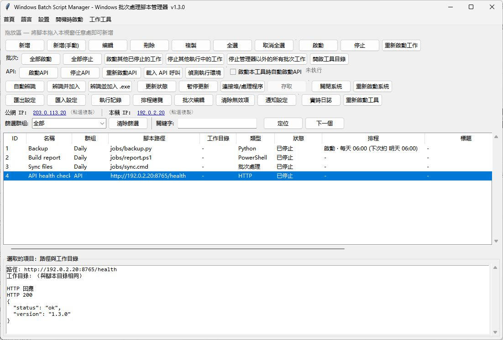

# WindowsBatchScriptManager · 繁體中文

[English](README.md) · [简体中文](README.zh-CN.md) · [繁體中文](README.zh-TW.md) · [日本語](README.ja-JP.md) · [한국어](README.ko-KR.md) · [Deutsch](README.de-DE.md) · [Français](README.fr-FR.md) · [Español](README.es-ES.md) · [Português (Brasil)](README.pt-BR.md) · [Русский](README.ru-RU.md)

在 Windows 上管理批次檔、Python、Node.js 與 PowerShell 工作，支援排程、佇列及遠端 API。

[下載 Windows 版](https://github.com/shellsec/WindowsBatchScriptManager/releases)
## 快速開始

桌面使用時直接開啟單檔 EXE。部署遠端 API 時，將 EXE 與 API 腳本放在伺服器的同一個資料夾，安裝 Python 相依套件後啟動服務。升級時請保留原有設定 JSON。

```powershell
python -m pip install fastapi "uvicorn[standard]"
python WindowsBatchScriptManager_api_server.py --host 0.0.0.0 --port 8765 --api-key "<API_KEY>"
```

選單「語言」的第一項是「跟隨系統」，第二項是 English。可手動選擇其他語言。



[API / MCP](docs/USER_GUIDE.en-US.md#remote-api-and-mcp) · [Apache-2.0](LICENSE) · [NOTICE](NOTICE)
