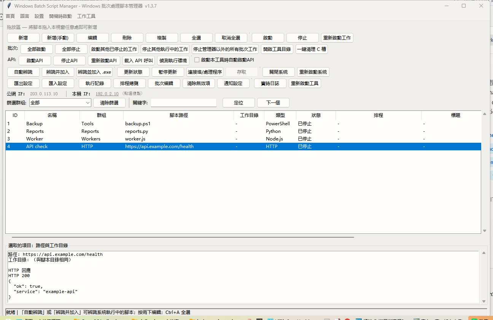

# WindowsBatchScriptManager · 繁體中文

[English](README.md) · [简体中文](README.zh-CN.md) · [繁體中文](README.zh-TW.md) · [日本語](README.ja-JP.md) · [한국어](README.ko-KR.md) · [Deutsch](README.de-DE.md) · [Français](README.fr-FR.md) · [Español](README.es-ES.md) · [Português (Brasil)](README.pt-BR.md) · [Русский](README.ru-RU.md)

在 Windows 上管理批次檔、Python、Node.js 與 PowerShell 工作，支援排程、佇列及遠端 API。

要讓 Codex 或 Claude Code 遠端操作，Windows 可用 WBSM 一鍵啟用 SSH/SFTP。Linux 和 macOS 直接使用已有的 SSH/SFTP，預設連接埠為 22。[設定與使用情境](README.zh-CN.md#ai-远程运维)

[下載 Windows 版](https://github.com/shellsec/WindowsBatchScriptManager/releases)

## 企業使用情境與解決方式

兩大用途：Windows 腳本任務管理，以及 AI 透過 SSH/SFTP 遠端維護。兩者可獨立使用，適合維護人力有限、已有多台掃描機、採集機、建置機或備份主機的團隊。

- 既有 Windows 業務環境不方便重裝：保留系統，在原機器上設定任務與遠端接入。
- 腳本、參數與解譯器分散：集中任務設定，使用範本、資料夾匯入與執行環境選擇。
- 需要排程、併發限制、保活或後續步驟：由執行中的管理器提供，不需逐項設定 Windows 工作排程器。
- 每次部署與排錯都要開遠端桌面：讓 Codex、Claude Code 透過 SSH 執行命令、SFTP 傳檔；範圍由 Windows 帳號權限決定。
- 日誌與結果難找：面板可查看已記錄輸出、執行歷史及 HTTP 回應；支援的腳本須先啟用日誌。
- 更新時擔心重複啟動：更新重新啟動會跳過啟動任務，恢復時核對處理程序身分，不保證所有故障自動恢復。
- 多台主機各自執行：可用 SSH 別名分別維護，目前沒有集中多機管理面板。

排程、佇列與保活依賴管理器持續執行。OpenSSH 是獨立服務；維護端斷線本身不會停止管理器任務，直接經 SSH 啟動的命令則取決於會話與啟動方式。GUI 操作仍可能需要互動桌面。處理程序存在不代表業務健康，也不代表已有完整命令稽核。正式部署前請驗證權限、升級恢復與持續運作。

## 任務 MCP

MCP 與 SSH 維護是獨立入口。MCP 可查詢、啟停與重新啟動已登記任務。v1.3.13 新增唯讀 `get_task_logs`（預設 100 行、最多 1000 行與末尾 64 KiB）和 `get_task_result`（最近已記錄執行結果）。沒有記錄或結束碼不代表成功，歷史狀態不等於即時狀態。需同時更新 API 腳本與主程式；本地任務管理與 SSH 不依賴 API 腳本。[限制說明](docs/MCP_TASK_DIAGNOSTICS.md)

## 快速開始

桌面使用時直接開啟單檔 EXE。部署遠端 API 時，將 EXE 與 API 腳本放在伺服器的同一個資料夾，安裝 Python 相依套件後啟動服務。升級時請保留原有設定 JSON。

```powershell
python -m pip install fastapi "uvicorn[standard]"
python WindowsBatchScriptManager_api_server.py --host 0.0.0.0 --port 8765 --api-key "<API_KEY>"
```

選單「語言」的第一項是「跟隨系統」，第二項是 English。可手動選擇其他語言。

## 一鍵清理 C 槽

C 槽清理不設七天限制，清理已識別的 `.tmp` / `.temp`、縮圖、支援的瀏覽器與著色器快取、舊任務日誌及崩潰傾印，並清除 DNS 快取。資源回收筒保留，受保護路徑及執行中瀏覽器快取會跳過。磁碟清理預覽列出已知快取位置，預設不勾選；Prefetch、個別還原點及關閉休眠可另選。右鍵可定位與複製路徑，休眠檔案有隱藏檔提示。關閉休眠需要管理員權限，也會關閉快速啟動；殘留檔案不強制刪除，不計為已釋放空間。



[API / MCP](docs/USER_GUIDE.en-US.md#remote-api-and-mcp) · [AGPL-3.0](LICENSE) · [NOTICE](NOTICE)


自 v1.3.13 起採 AGPL-3.0-only，允許商用。再散布及修改版網路服務須依條款提供對應原始碼，不表示所有私人修改都必須公開至 GitHub。[授權與相依套件聲明](THIRD_PARTY_NOTICES.md)
